<div align="center">


# NPATI Agent

### Your self-hosted AI business agent. Tell it what you need, and it does the work.

Websites, games, mobile apps, APIs and databases, built from a chat message.<br/>
A team of AI agents for your company, with memory, goals, automations, email and Telegram.<br/>
334 AI providers, 3,000+ models, 16 languages. Runs on your own server with Docker.

[](LICENSE)
[](#quick-start)
[](#16-languages)
[](#ai-providers-and-models)
[](https://www.npati.com/npati-ai-agent)
[](https://en.npati.com/category/npati-ai-agent/)

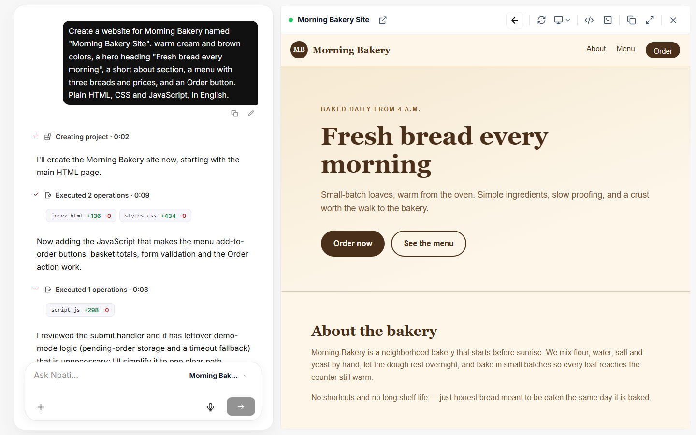

</div>

<div align="center">

<table>
  <tr>
    <td align="center"><a href="#quick-start">Quick start</a></td>
    <td align="center"><a href="#first-steps-after-install">First steps</a></td>
    <td align="center"><a href="#build-from-a-chat-message">Build from chat</a></td>
    <td align="center"><a href="#projects">Projects</a></td>
  </tr>
  <tr>
    <td align="center"><a href="#databases-and-data-studio">Databases</a></td>
    <td align="center"><a href="#companies-and-ai-agents">Companies and agents</a></td>
    <td align="center"><a href="#business-goals-and-memory">Goals and memory</a></td>
    <td align="center"><a href="#content">Content</a></td>
  </tr>
  <tr>
    <td align="center"><a href="#automations">Automations</a></td>
    <td align="center"><a href="#email-and-ai-inbox">Email and inbox</a></td>
    <td align="center"><a href="#integrations-and-telegram">Integrations</a></td>
    <td align="center"><a href="#ai-providers-and-models">AI providers</a></td>
  </tr>
  <tr>
    <td align="center"><a href="#16-languages">16 languages</a></td>
    <td align="center"><a href="#safe-by-default">Safety</a></td>
    <td align="center"><a href="#community-videos">Community videos</a></td>
    <td align="center"><a href="#support-the-project">Support</a></td>
  </tr>
</table>

</div>

---

<div align="center">

## What is NPATI Agent?

NPATI Agent is an AI assistant that does not stop at answers. You write in plain words, and it builds and runs things:<br/>
it writes the code, checks it, shows the result next to the chat and remembers your business.

Everything runs on your own computer or server. Your data, your keys, your models.

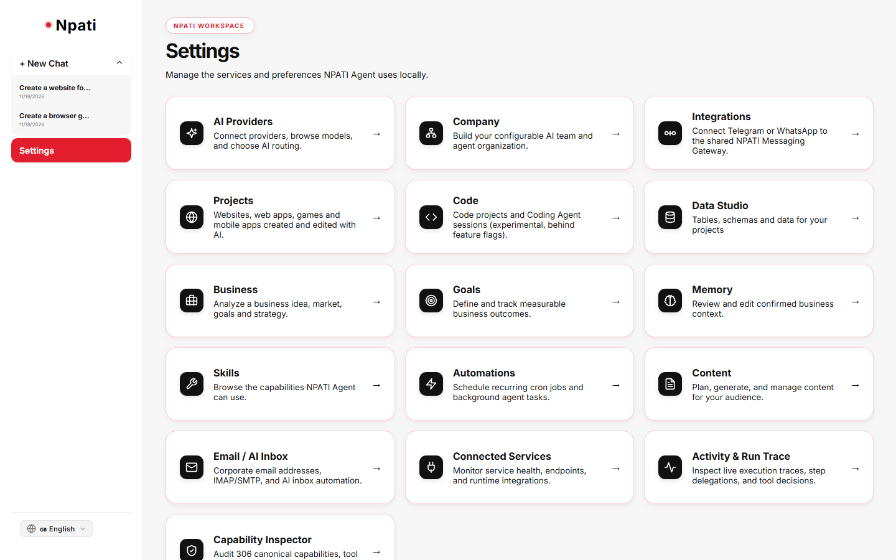

<sub>Every part of the agent in one place: AI providers, company, projects, Data Studio, goals, memory, automations, email and more.</sub>

</div>

---

<div align="center">

## Quick start

You need Docker with Compose v2 and Git.

</div>

```bash
git clone --recurse-submodules https://github.com/andrii-koss/npati-ai-agent
cd npati-ai-agent
cp .env.example .env
docker compose up --build
```

<div align="center">

Open **http://localhost:3000** and sign in. The chat is at **http://localhost:3000/chat**.<br/>
To use another port, change `NPATI_WEB_PORT`, `NPATI_WEB_ORIGIN` and `NPATI_AGENT_PUBLIC_DOMAIN` in `.env`. On Windows Command Prompt use `copy .env.example .env`.<br/>
For a server with a domain, see the [Dokploy guide](docker/DOKPLOY_DEPLOYMENT.md).<br/>
Before you open the installation to other people, change every password and key in `.env`.

</div>

---

<div align="center">

## First steps after install

| Step | What to do |
|:---:|:---|
| 1 | **Connect AI.** Settings → AI Providers: pick a provider, paste your key, add a model, set it as default. |
| 2 | **Tell it about your business.** A few sentences in the chat create your business profile. |
| 3 | **Create a company and a team.** "Create the company Morning Bakery with a main agent and a copywriter." |
| 4 | **Connect Telegram.** Create a bot with @BotFather, paste the token in Settings → Integrations → Telegram. |
| 5 | **Build something.** "Make a website for my bakery with a menu and an Order button." |
| 6 | **Teach it your facts and goals.** Prices, hours, suppliers, and a goal like "500 orders by the end of the year". |

</div>

---

<div align="center">

## Build from a chat message

Websites and web apps (HTML, React, Next.js), browser games, Python desktop games, mobile apps (Expo, Flutter),<br/>
and backends (Node.js, FastAPI). The agent writes the files, runs the checks and opens a live Preview next to the chat.<br/>
Ask for a change in plain words, and it changes only what you asked for.

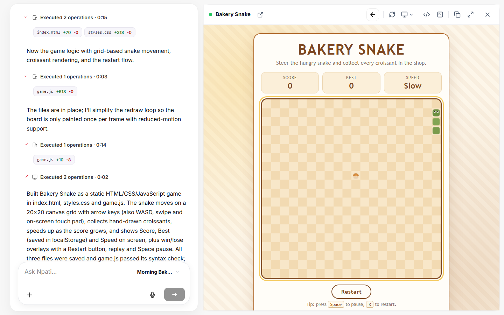

<sub>A browser game made in the chat, playable right away.</sub>

</div>

---

<div align="center">

## Projects

Every website, game, app and API the agent made, on one page. Search, filter by company, type or status,<br/>
open the live site in a new tab, or jump back to the project chat with **Edit in chat**.

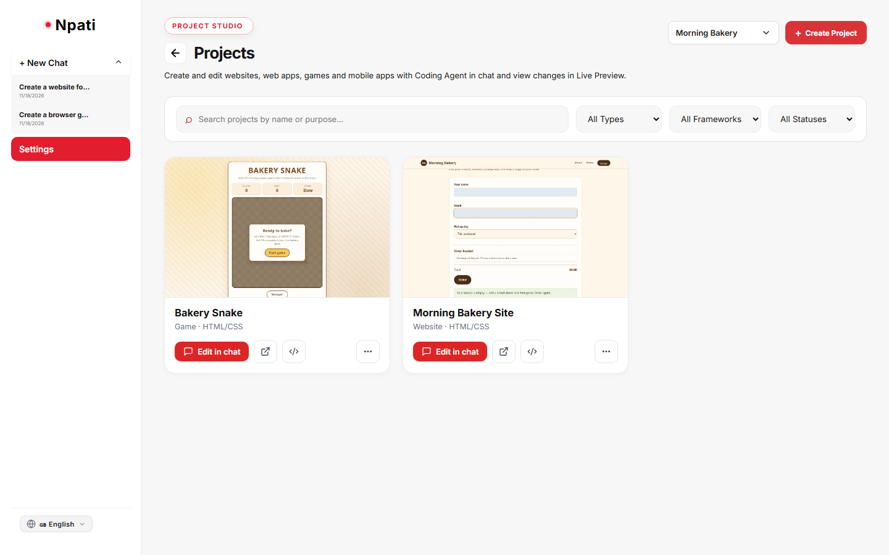

</div>

---

<div align="center">

## Databases and Data Studio

Ask "create tables for customers and orders" and the agent builds a real database for your project,<br/>
links the tables and adds sample rows. It asks for your approval before it changes data.

In **Data Studio** you see tables, columns and rows, add, edit and delete records with the mouse,<br/>
import and export CSV or JSON, and choose which tables a website may read.<br/>
Your site can show live data from its database: add a product, and it appears in the catalog.

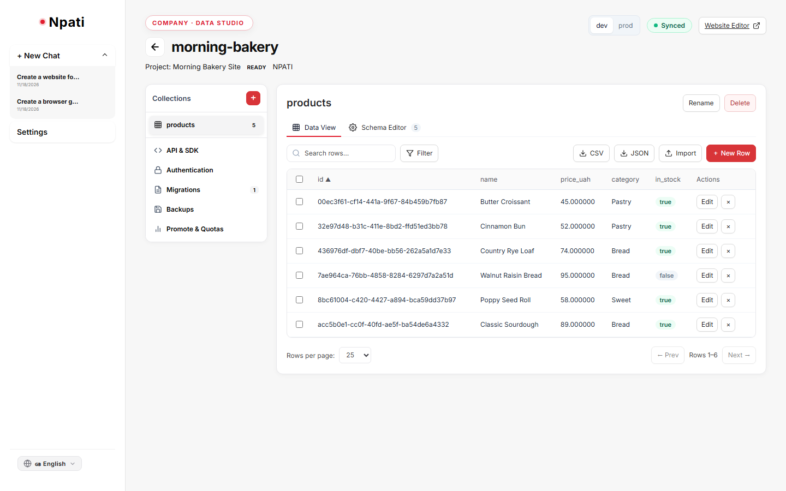

</div>

---

<div align="center">

## Companies and AI agents

Create a company and a team of AI agents. Each agent has its own role, instructions, AI model and tools.<br/>
The main agent splits a task and hands parts to the right specialist. An agent only uses the tools you allowed.

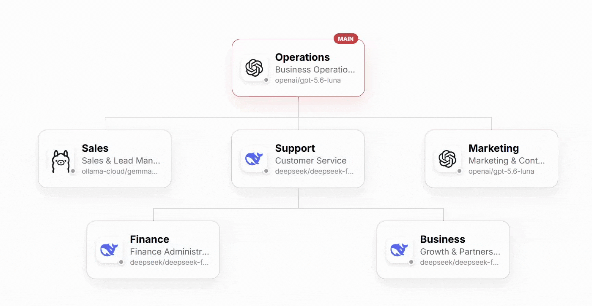

<sub>Company settings and the agent team.</sub>

<br/><br/>

### Company page

Every company has its own page with details and instructions that belong only to that company:<br/>
website, industry, description, products and services, languages, brand tone and company instructions.<br/>
Add durable facts and rules to the company memory and upload documents (PDF, DOCX, XLSX, CSV and more)<br/>
to the company knowledge. The AI reads all of this, understands the company and answers in its context.

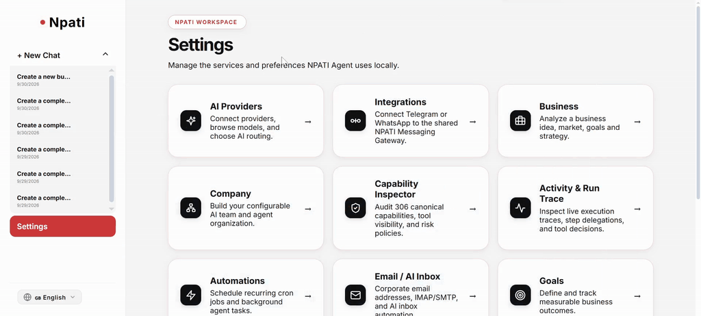

<br/><br/>

### Business profile

Describe your business idea on the Business page: name, logo, stage (from idea to scaling), industry and niche,<br/>
country and market, business model, products or services and target audience.<br/>
Link a goal and memory facts to the business. When the idea is ready, turn it into a company with one click:<br/>
the profile, goals and confirmed memory move into the new company.

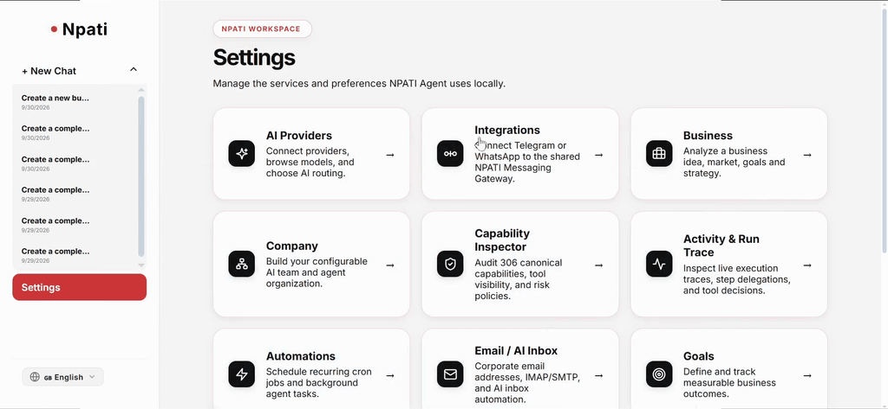

</div>

---

<div align="center">

## Business goals and memory

Set measurable goals with a number, a date and a priority, and assign them to an agent.<br/>
Tell the agent your facts once (prices, hours, suppliers). It remembers them after a restart,<br/>
updates them when they change, and keeps each company's memory separate.

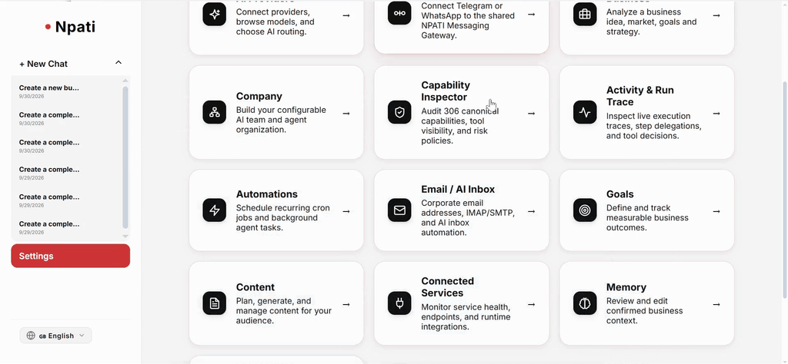

<sub>Goals with targets, dates and the responsible agent.</sub>

</div>

---

<div align="center">

## Content

Posts, articles and descriptions written by the agent, saved in one place to read and edit.<br/>
It writes in your brand's voice and for your audience.


</div>

---

<div align="center">

## Automations

Agents wake up on a schedule: "every Monday at 9:00, write a sales report". Pick the agent, the time and your time zone.<br/>
Run it now, pause it, and see the history of every run.

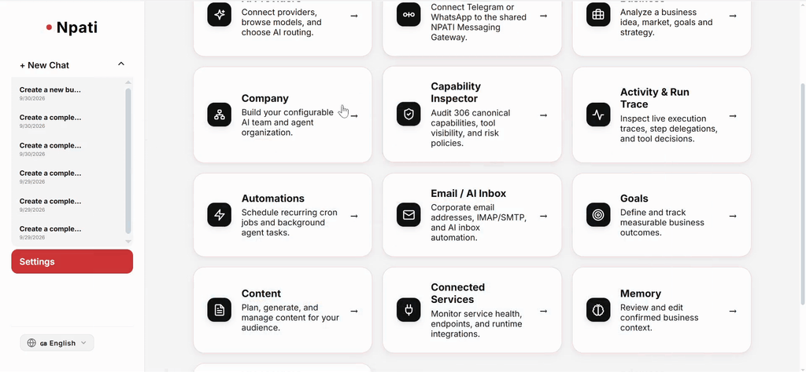

</div>

---

<div align="center">

## Email and AI inbox

Connect the company mailbox (IMAP/SMTP). All conversations in one inbox, grouped into threads.<br/>
The AI writes a draft, you read it, edit it and decide to send. Templates for common answers,<br/>
spam detection and a block list for unwanted senders.


<sub>Company mailboxes.</sub>

<br/><br/>

### AI inbox

See every email the AI has answered and follow each conversation as it happens: status, priority and thread history.<br/>
Reply to any email yourself, send or edit the AI draft, or press Take Over to handle a thread by hand and Return to AI later.<br/>
Mark important customers as VIP, see the customer profile with past conversations, archive threads and mark spam.

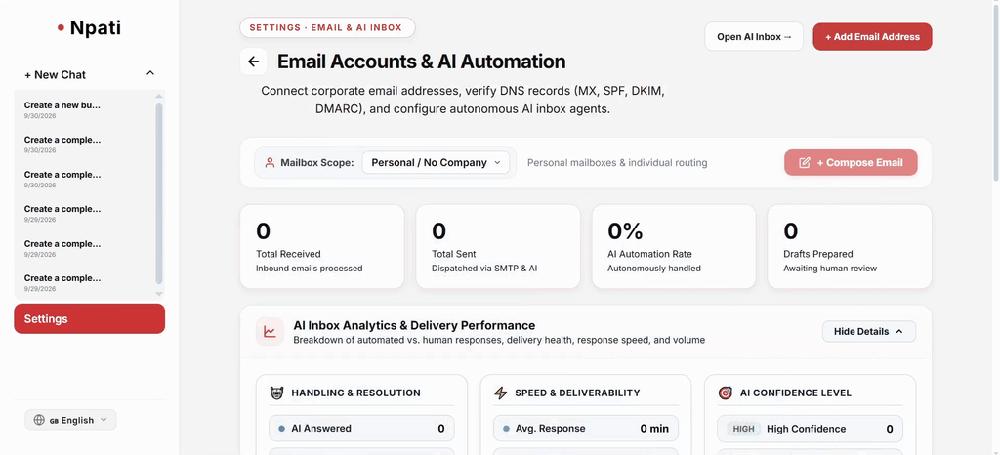

</div>

---

<div align="center">

## Integrations and Telegram

Talk to your agent from Telegram: tasks, files, company actions and automations from your phone.<br/>
Inbound webhooks let other services send events to the agent. The secret URL stays hidden until you ask for it.


</div>

---

<div align="center">

## AI providers and models

Not tied to one AI. Choose from **334 providers and 3,000+ models**: paid and free, cloud and local.<br/>
Pick a default model, or give each agent its own. Keys are stored encrypted.

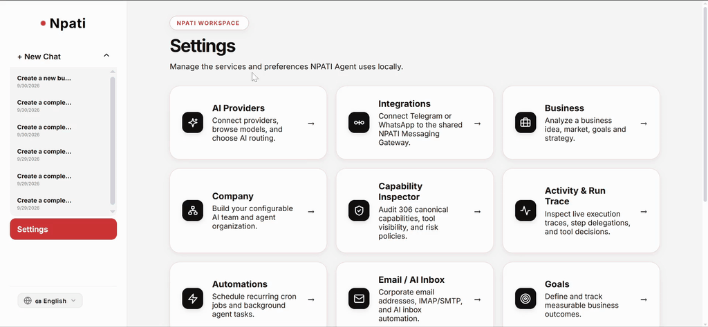

</div>

---

<div align="center">

## 16 languages

The interface and the agent work in **English, Ukrainian, German, French, Spanish, Italian, Polish, Portuguese,<br/>
Dutch, Turkish, Russian, Chinese, Japanese, Korean, Arabic and Hindi**. The agent answers in the language you write in,<br/>
and understands typos and transliteration.

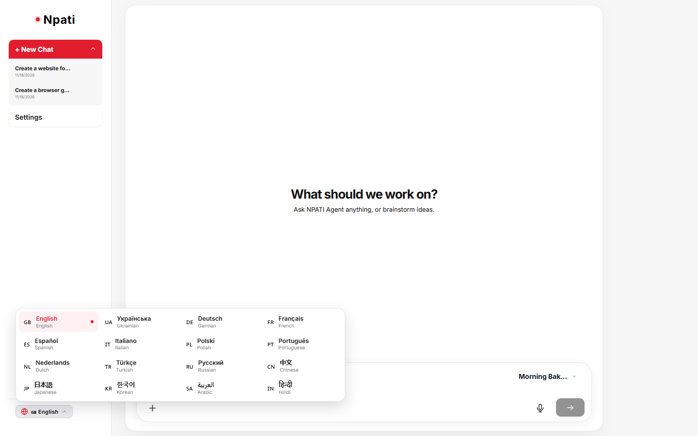

</div>

---

<div align="center">

## Safe by default

Deleting projects or data, database changes and risky commands always ask for your approval in the chat.<br/>
Every step of the agent is recorded in **Activity**, and the **Capability inspector** lists honestly what works, what is partial and what is planned.<br/>
Instructions hidden in web pages, files, emails or database rows are not followed.

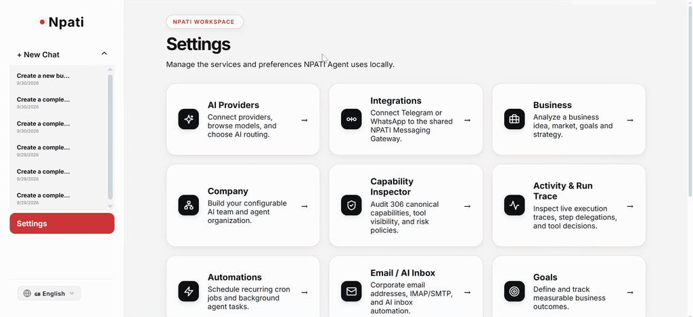

</div>

---

<div align="center">

## Community videos

<table>
  <tr>
    <td align="center" width="320">
      <br/>
      <b>Your video here</b><br/>
      <sub>Review, tutorial or demo</sub>
    </td>
    <td align="center" width="320">
      <br/>
      <b>Your video here</b><br/>
      <sub>YouTube, TikTok or Instagram</sub>
    </td>
    <td align="center" width="320">
      <br/>
      <b>Your video here</b><br/>
      <sub>Any language is welcome</sub>
    </td>
  </tr>
</table>

🎬 **Made a video about NPATI Agent?** Open an [issue](https://github.com/andrii-koss/npati-ai-agent/issues/new?title=Community%20video) with the link,<br/>
and we will feature it here and on [npati.com](https://www.npati.com/npati-ai-agent).

</div>

---

<div align="center">

## More from NPATI

[NPATI AI Agent](https://www.npati.com/npati-ai-agent) · [NPATI for ChatGPT](https://www.npati.com/plugins/npati-for-chatgpt) · [Content automation](https://www.npati.com/plugins/npati-content-automation) · [All plugins](https://www.npati.com/plugins) · [Blog and updates](https://en.npati.com/category/npati-ai-agent/)

</div>

---

<div align="center">

## Documentation

[Known issues](KNOWN_ISSUES.md) · [Contributing](CONTRIBUTING.md) · [Security policy](SECURITY.md) · [Third-party notices](THIRD_PARTY_NOTICES.md) · [User guide](docs/README.md)

</div>

---

<div align="center">

## License

NPATI Agent is **source-available** under the [Elastic License 2.0](LICENSE). Licensor: Andrii Kostashchuk.<br/>
You may use it, change it and run it on your own servers, including inside your company.<br/>
You may not offer it to others as a hosted or managed service, work around its license key (installation authorization),<br/>
or remove its licensing notices. Third-party components keep their own licenses.

</div>

---

<div align="center">

## Support the project

NPATI Agent is built by one developer. If it saves you time, you can help it grow.

<a href="https://secure.wayforpay.com/donate/acoffee"></a>
&nbsp;&nbsp;
<a href="https://secure.wayforpay.com/donate/npati"></a>

<table>
  <tr>
    <td align="center" width="260">
      <a href="https://secure.wayforpay.com/donate/acoffee"></a><br/>
      <b>☕ A coffee for the author</b>
    </td>
    <td align="center" width="260">
      <a href="https://secure.wayforpay.com/donate/npati"></a><br/>
      <b>Project development</b>
    </td>
  </tr>
</table>

A star on GitHub helps too. Thank you.

</div>
