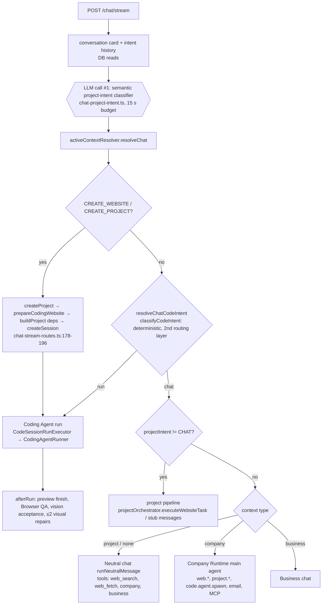

# NPATI Agent — architecture audit, single-chat E2E and speed

Branch `feat/code-run-discipline` (HEAD at audit start: `4985b4e`). Local isolated Docker stack; models
`deepseek/deepseek-flash` and `ollama-cloud/gemma4:31b` (the only two connected). Facts cite code; E2E evidence is in
`artifacts/measure-e2e/` (not committed) and summarised below.

## 1. Actual routing of one chat message

## 2. Capability matrix

| # | Component / capability | Status | Evidence |
|---|---|---|---|
| 1 | Chat Runtime (SSE, admission, background runs) | Already Implemented | `chat-stream-routes.ts`, `code-background-runs` |
| 1 | Coding Agent loop (tools, waves, policy, sandbox) | Already Implemented | `coding-agent-runner.ts`, `coding-agent-tool-waves.ts` |
| 1 | Company Runtime main agent | Already Implemented | `company-runtime.ts`, `company-tool-runtime.ts` (web, project.data, code.agent.spawn, email, MCP) |
| 1 | One logical Main Agent across contexts | **Partial / Duplicated** | three separate "main" executors (neutral chat, Company Runtime, Coding Agent) chosen by the router; in a project context the Company main agent is never used |
| 2 | Intent routing | **Duplicated** | deterministic `classifyProjectIntent` + LLM semantic classifier (`chat-project-intent.ts:118`) + deterministic `classifyCodeIntent`/`resolveChatCodeIntent` (`code-intent-routing.ts`) |
| 4 | LLM call before every message | **Yes (most messages)** | semantic classifier runs unless a deterministic guard answers (`chat-project-intent.ts:108-117`) |
| 5 | Neutral chat calling Coding Agent / Data Studio | **Missing** | neutral chat tools are only `npati_company_action`, `web_search`, `web_fetch`, `npati_business_profile` (`chat-tool-orchestrator.ts`) |
| 5 | Coding Agent calling Web Research / Data Studio | Already Implemented | `code.web.search/fetch`, `code.data.*` (contextual / intent tiers) |
| 6 | Changing the tool set during one task | **Partial** | tools chosen once per run at turn 0 from message regex (`coding-agent-runner.ts:309`, `code-tool-visibility.ts`) |
| 7 | Context between chat messages → Coding Agent | **Partial** | runner starts with system prompt (Company memory + PROJECT.md) + current message only (`coding-agent-runner.ts:366`); chat answers (e.g. web research) are not passed |
| 8 | Hand-off / compaction / recovery | Already Implemented | inbox + resume (C10), compaction (`context-compactor.ts`, runner compaction), transient provider retry |
| 9 | Planning call | Gated (≥900 chars / 8 lines) | `chat-task-plan.ts:20` |
| 9 | Self-review | Risk-gated | `code-self-review-risk.ts` |
| 9 | Verification / Browser QA / visual repair | Implemented; visual repair now only on major findings | `code-session-run-executor.ts`, `website-visual-acceptance.ts` |
| — | Web access | see §3 | |
| — | Plain chat with an image | **Broken (local stack)** | `OMNIROUTE_VISION_MODEL=openai/gpt-5.6-luna` not connected → HTTP 401 (`chat-turn.ts:225-229`) |

## 3. Web access architecture (verified live)

| Channel | Used by | Path | Local stack |
|---|---|---|---|
| Search | chat `web_search`, `code.web.search`, Company `web.search` | OmniRoute `/api/v1/search` (`ollama-search`) | works |
| Fetch | chat `web_fetch`, `code.web.fetch`, `analyzeUrl` | NPATI SSRF validator (`NPATI_WEB_FETCH_ALLOWED_HOSTS`) → OmniRoute `/api/v1/web/fetch` → fallback Crawl4AI | OmniRoute fetch has no provider keys; Crawl4AI 0.9.2 works; validator denies all when the list is empty |
| Company `web.fetch` | Company agents | OmniRoute `executeTool("web.fetch")` **before** the NPATI validator, fallback crawl through it | inconsistent with chat: would bypass the allowlist once OmniRoute fetch keys exist |
| Browser Use worker | Company agents only | per-task domain allowlist + private-IP block | not reachable from the main chat |
| Browser QA | own Preview only | — | — |

E2E used a local-only, owner-approved test allowlist (public zones `*.com, *.com.ua, *.ua, …`); SSRF private/reserved
address checks stay active. Reverted after the tests.

## 4. Single-chat E2E (one Company, one Project, one chat per run)

Harness: `node scripts/measure-coding-scenarios.mjs --suite storefront` (real Chat API, SSE, read-only SQL, OmniRoute
logs, Preview HTTP through the authenticated proxy, Data Studio API). Each run: new Company; S1 → S2 → S3 → S3 retry
→ S4 (→ follow-up approval message if still pending) → S5 (reference photo, synthetic, no real brand) → S6.
The test user answers approval dialogs like an attentive user: sample-data inserts approved, everything else declined.

Baseline = branch HEAD `4985b4e` (3 runs × 2 models). After = `c111899` (fixes 1–11, 3 runs × 2 models).
Fix 12 (`26bc55f`) landed after the after-series; it is covered by its regression test only.

| Scenario | DeepSeek baseline | DeepSeek after | Gemma baseline | Gemma after | Verdict after |
|---|---|---|---|---|---|
| S1 create store + Preview | 3/3 | 3/3 | 2/3 | 3/3 | **PASS** (all pages 200; Browser QA ok on DeepSeek, Gemma pages report a console error) |
| S2 web research, no changes | **0/3** | **3/3** | 1/3 | **3/3** | **PASS** (real search, 1–2 pages fetched, sources linked, 0 writes) |
| S3 database products/categories/orders | 3/3 | 3/3 | 3/3, all `stopped` | 3/3 `completed` | **PASS** with gap: no foreign keys (RC-2) |
| S3 retry — no duplicates | 3/3 | 3/3 | 3/3 | 3/3 | **PASS** |
| S4 connect DB, show products | wiring 2/3, rows 0 | wiring 2/3, rows seeded | wiring 2/3, rows 0 | wiring 1/3 | **BLOCKED** (environment, RC-E1) |
| S5 redesign from photo | 1/3 | 1/3 | 0/3 | 0/3 | **FAIL** (model quality, reviewer output, environment-induced console error) |
| S6 reuse earlier analysis | **0/3** | 1/3 | **0/3** | 1/3 | **PARTIAL** — context now reaches the agent; edits sometimes stop on loop guards |

DeepSeek after-run 3: S4–S6 ended with `HTTP 402 Insufficient Balance` (account credit exhausted during these tests);
Gemma after-run 3 S5 hit the same because the vision reviewer resolves to DeepSeek. Those cells are BLOCKED, not FAIL.

Additional checks (image `26bc55f`, Gemma): edits in English and Portuguese → PASS (routed to the Coding Agent, colour
written to `app/globals.css`, answer in the request language). Research in en/pt sent **without** chat history → the
model asked which products the store sells (no fabrication); with history (single-chat E2E) it worked → neutral chat
lacks project context (RC-6). Restart during runs: 9 in-flight runs were reconciled to `interrupted`
(`lease_expired`), never reported as success; no automatic resume. Compaction of long history: not triggered by these
chats (NOT TESTED live; unit tests exist). `code.finish`: 25 of 33 code runs ended through it.

## 5. Metrics (medians per scenario; seconds, thousands of tokens)

| Scenario | Model | Total base→after | First SSE event | First tool action | LLM requests | Input tok | Model time | Tool time |
|---|---|---|---|---|---|---|---|---|
| S1 | DeepSeek | 244 → 246 | 17 → 5 | 21 → 8 | 8 → 10 | 136 → 234 | 115 → 170 | 73 → 16 |
| S1 | Gemma | 311 → 102 | 9 → 8 | 12 → 10 | 15 → 13 | 230 → 124 | 37 → 28 | 126 → 5 |
| S2 | DeepSeek | 22 → 43 | 2 → 2 | – | 1 → 1 | 7 → 40 | – | – |
| S3 | DeepSeek | 38 → 36 | 2 → 2 | 4 → 4 | 8 → 9 | 111 → 152 | 18 → 28 | 5 → 5 |
| S3 | Gemma | 33 → 27 | 1 → 1 | 4 → 4 | 9 → 10 | 108 → 130 | 19 → 18 | 5 → 6 |
| S3 retry | Gemma | 23 → 7 | 2 → 1 | 4 → 4 | 3 → 2 | 35 → 24 | 6 → 4 | 1 → 0 |
| S4 | DeepSeek | 235 → 234 | 2 → 3 | 6 → 5 | 14 → 12 | 435 → 395 | 118 → 144 | 86 → 80 |
| S5 | DeepSeek | 471 → 429 | 1 → 1 | 8 → 8 | 20 → 17 | 600 → 569 | 260 → 272 | 20 → 14 |
| S6 | DeepSeek | 55 → 47 | 2 → 2 | 5 → 4 | 11 → 9 | 245 → 241 | 45 → 40 | 6 → 4 |

S2 is slower after the fix because it now searches and fetches pages instead of answering from memory. Totals over
3 runs: DeepSeek input 4.77 M → 4.96 M tokens (after-runs did real work in S2/S6); Gemma 3.57 M → 2.57 M tokens and
3 688 s → 1 569 s wall time. "LLM requests" are OmniRoute `[USAGE]` lines; OmniRoute logs no usage for some Gemma
chat-path requests (under-count). Routing (message → first SSE event): 1–3 s for edits/data, 5–17 s for creation
(includes scaffold and prepared dependencies). DeepSeek S5 split: model 272 s, tools 14 s, the rest is system wrapping
(reference vision analysis, preview build/start, Browser QA, vision review 30–42 s each, repair runs).

## 6. Root causes

Fixed (separate commits, each with a regression test):

| # | Root cause | Evidence | Commit |
|---|---|---|---|
| 1 | Coding Agent saw only the last 6 chat messages at 600 chars; the research answer fell out | S6: "у цьому чаті немає результатів попереднього аналізу" | `e8c119c` |
| 2 | `classifyCodeIntent` turned "…аналізу… покращи…" into a read-only review, overriding the semantic intent | S6: read-only 21-tool catalogue | `1e0e8e9` |
| 3 | DeepSeek (thinking) rejects forced `tool_choice=web_search`; the tool-less fallback answered from memory | `Thinking mode does not support this tool_choice`; S2 "немає інструмента вебпошуку" | `9163d56`, `0b5049d` |
| 4 | `web_search` used the free-form dispatcher: capitalised words → "X official website" | S2: "Next.js official website", "їхній official website" | `a07496b`, `0b5049d` |
| 5 | Vision review timeout 45 s vs measured 30–42 s | `42232ms disconnect: request_signal_aborted` | `c1aaf77` |
| 6 | Loop guard counted only file writes | S3 Gemma `ten model turns without source progress` after creating tables | `48cca91` |
| 7 | Every website run forced a full `next build`, also Data Studio-only runs | S3 retry 543 s; `code.verify.run` 198 s, no file changed | `61e230b`, `c111899` |
| 8 | Malformed verdict JSON → `blocked` without retry | `Expected ',' or '}' after property value` | `a87d5df` |
| 9 | **`approvalDecision.wait` read once and returned "pending"** — every Data Studio approval expired in ms while the log claimed 900 s | requested 01:11:01.744, `code_approval_timeout waitedMs:900000` at 01:11:01.818 | `a0704ef` |
| 10 | Cycle detector signed data tools without arguments: 3 tables = "cycle" | `repeating cycle [schema.apply->schema.apply]` | `26bc55f` |

Open (not changed — need a decision, a new published version, or environment):

| # | Root cause | Evidence | Recommendation |
|---|---|---|---|
| RC-E1 | Environment: `NPATI_PROJECT_API_PUBLIC_URL=http://127.0.0.1:13001` is the sandbox itself from inside the sandbox | `/api/products` → 500; a unique row inserted via Data Studio never appears on the live page (2 projects); sites fall back to static data | public URL reachable through the sandbox egress proxy; do not open the sandbox network |
| RC-2 | `code.data.schema.apply@1` allows only create_collection/add_field/create_index; Data Studio supports `create_relation` (FK) but the published schema forbids it | `category_id uuid` without `REFERENCES` | publish `@2` or `code.data.relation.create@1` |
| RC-3 | Browser QA keeps only the count of console errors (deliberate), so repairs cannot fix a blank page | Gemma S5: blank page, 2 repairs without effect | owner decision: bounded, secret-redacted first error line for repairs |
| RC-4 | The vision reviewer is always DeepSeek Flash, sometimes returns `<｜｜DSML｜｜…>` | Gemma S5 after-run | separate reviewer model, JSON response format |
| RC-5 | The agent claims "catalog shows products from the database" after `next build` only | live route 500 vs claimed success | require a Preview HTTP check of the data route before such a claim |
| RC-6 | Neutral chat in a project context gets no project description | en/pt research without history → clarification | pass project name/description |
| RC-7 | OmniRoute admits one heavy request per key | `chat_admission_busy activeHeavy:1` | size the lane for concurrent users |
| RC-8 | Company `web.fetch` calls OmniRoute fetch before the NPATI SSRF allowlist | `company-tool-runtime.ts:134` | use the same validated provider |
| RC-9 | The allowlist cannot express `www.<any>.com` (one-label wildcard by design) | most `www.` pages refused | curated research domains |

## 7. Duplicated / unnecessary processing

- Three routing layers per message; the LLM classifier runs for most messages (+1 call, 1–3 s); their disagreement
  caused root cause 2.
- Three separate "main" agents (neutral chat, Company Runtime, Coding Agent); the Company main agent — the broadest
  toolset — is never used in a project chat.
- Forced full build on unchanged workspaces (fixed, #7).
- Reference image analysed by a separate vision call and again by the agent (`code.image.view`).
- Vision review 30–42 s per verdict, up to 3 verdicts per redesign.

## 8. Prioritised plan

1. E2E environment: Project API URL reachable from the sandbox (RC-E1), DeepSeek credit — then re-run S4/S5.
2. Relations for the agent: `code.data.schema.apply@2` (RC-2).
3. One logical Main Agent per chat: a coordinator that calls Coding Agent, Web Research and Data Studio as tools
   (reuse the Company Runtime tool set) instead of three executors chosen up front.
4. Collapse routing: deterministic first, LLM classifier only when unsure.
5. Runtime verification before data/UI success claims (RC-5); owner decision on console-error text (RC-3).
6. Separate vision reviewer with JSON mode (RC-4); a model profile for Gemma.
7. Project context for neutral chat (RC-6); Company `web.fetch` through the SSRF-validated provider (RC-8).

## 9. Follow-up on 2026-10-23

See [the architecture follow-up](npati-agent-architecture-followup-2026-10-23.md) for the current patch, audit and evidence.

Overall **BLOCKED**: the user confirmed there is no existing Project API endpoint reachable through the sandbox egress proxy. Full six-step paid reruns were not performed. This report's earlier E2E measurements remain historical.

Implemented locally: schema.apply@2 / manifest v16 with v1 and old session manifests preserved; bounded canonical Browser QA diagnostics delivered to the Coding Agent; functional QA gate before visual inference/repair; native Node proxy configuration; static sandbox Project API URL preflight. Real disposable sandbox/Chromium checks and a temporary-table PostgreSQL FK check passed. No production, RBAC, approval policy or sandbox network/isolation changes, push or merge.

The actual running runtime mode is shared (bubblewrap + slirp4netns), despite the stack name containing isolated. One logical coordinator should reuse Chat Orchestrator's context/transport and Company Runtime's authorized execution, with Coding Agent as its existing coding tool/run. A new Main Agent would duplicate these components. Universal single-chat behavior is not yet certified.
