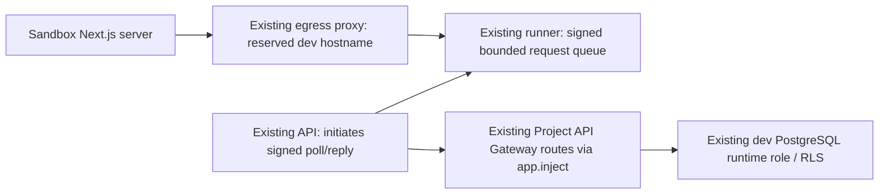

# NPATI Agent: Project API access and single-chat E2E - 2026-10-23

Overall product result: **FAIL**. Sandbox -> Project API and deterministic real data acceptance: **PASS (local shared runtime)**. Photo design: **BLOCKED** by missing active DeepSeek credentials. The six-stage conversation was exercised; it did not meet full acceptance.

## Network architecture and implemented path

The stack npati-isolated-source-20261011 actually uses the shared bubblewrap/slirp4netns runtime. Its runner has control/egress networking; the API owns application/database networks. The generic HTTP proxy and kernel firewall prohibit private destinations even for the trusted proxy. Docker DNS names and a direct private-IP exception are therefore unsuitable. 127.0.0.1:13001 inside a project points to that project, not the API.

The existing components provide the necessary boundaries: the egress proxy parses HTTP, the API already initiates HMAC-authenticated runner control requests, and the existing Project API Gateway validates publishable keys and enforces RLS. Added bounded request exchange to these components rather than a new gateway/proxy service.

- Opt-in NPATI_PROJECT_API_SERVICE_BINDING=dev; default remains disabled. NPATI_PROJECT_API_SANDBOX_URL=http://project-api.npati.internal is consistent in local API/worker/runner. Browser scaffold retains the public URL; the private hostname is server-only.
- This hostname is a fixed service binding in the existing proxy, not a DNS/private-IP exception. Only parsed /v1/projects/<uuid>/... requests with dev publishable keys reach the existing Gateway. Cookies, admin paths, production keys, secret keys, arbitrary forwarding URLs, redirects, nested CONNECT and upgrades are refused. HTTP CONNECT is parsed rather than tunneled.
- Existing HMAC timestamps, nonces and replay protection remain mandatory. The signing secret stays in the trusted supervisor. Queue: 64 pending requests, 15-second expiry, two API consumers; request/response bounds: 1/8 MiB. Timed-out mutations are never retried automatically.
- No new host port, public listener, Docker network attachment, PostgreSQL exposure or firewall relaxation. General SSRF/DNS/IP checks remain unchanged for general egress.
- Implemented and exercised on the shared provider. Isolated-provider native proxy support remains covered, but this private control binding explicitly requires shared mode; isolated use is not certified by this live run.

Local images installed: npati-project-api-control:20261023 (API/worker), npati-project-api-control-runtime:20261023 (runner). Reviewable override/build inputs are in artifacts/project-api-control-20261023/. Only local source/test services were recreated; no production deployment, push or merge.

## Deterministic real data acceptance

Driver: scripts/verify-project-api-nextjs-e2e.mjs. Evidence: artifacts/project-api-control-20261023/deterministic-e2e.json. Normal installation session and owner REST routes create one disposable dev project/backend; no fabricated authentication or direct persistent SQL writes.

| Step | Result | Elapsed | Evidence |
|---|---|---:|---|
| Test project and backend | PASS | 186 ms | Authorized REST setup |
| products, unique row and publishable-key authorization | PASS | 632 ms | Real Gateway 200; invalid key 401 |
| Next.js website in shared sandbox | PASS | 19,879 ms | Existing prepared runtime profile and Preview |
| Real row in Chromium | PASS | 929 ms | NPATI_CONTROL_ee9a4843: 123.450000 |
| DB update appears in Chromium | PASS | 913 ms | Same row updated to _UPDATED: 987.650000 |
| Break only test website API path | PASS | 13,727 ms | Explicit PROJECT_API_UNAVAILABLE; no products; same-origin API returns 503 |
| Restore path and verify real row | PASS | 16,335 ms | Updated row reappears; same-origin API 200 |

Total: **52,601 ms**, LLM calls **0**, input/output tokens **0**, model tool calls **0**; 28 harness HTTP requests. Stage times include test-site Preview refresh when synchronizing the test path file. Neither the shared API nor database was stopped to simulate the outage. Later API/worker restarts installed local source corrections and were separate from outage acceptance.

Final-source deployment recheck: post-deploy-network-check.json is PASS and deterministic-final.png captures the real updated row. Project 8b7099df-2c87-40ba-875d-4eb99fe5489d; row aabe2dce-7cb6-4a6e-97f2-79501c686e2c. Credentials and signed Preview URLs are not reproduced.

Earlier fixture attempts remain diagnostic history: wrong fixture endpoint /collections instead of /data; stale expected fingerprint after a managed policy change; and changing canonical files without refreshing Preview. The final PASS supersedes these attempts, without deleting them.

## Additional deterministic corrections

1. Managed dev auth policy writes previously changed RLS without updating the expected schema fingerprint. The existing migration lock now encloses before/after introspection; only target-table policy/RLS differences may update the snapshot. Existing drift and unrelated schema changes remain refused. Policy SQL, RBAC, approvals and production behavior are unchanged.
2. Live S3 found schema.apply@2 was offered to the model but the policy adapter selected the first same-name schema, v1. The existing policy lookup now receives the requested version and resolves that exact published schema. Legacy v1 remains valid; unpublished versions still reach the existing unknown_tool_version denial. No policy phase or permission was removed.
3. Live Stop initially failed closed with audit_unavailable / Workspace access denied: the session route omitted its authorized workspace from the audit input. It now passes ctx.workspaceId to the existing audit writer. Live Stop subsequently returned 200 with cancellation recorded; mandatory audit failure behavior remains tested.

## Existing orchestration

Keep Chat Orchestrator as the transport, authorized context and conversation owner. Reuse Company Runtime for authorized company planning/tool lifecycle and Coding Agent as the bounded coding executor. Neutral conversations retain the existing chat tool loop. No fourth Main Agent, transcript store or router was introduced.

Implemented bounded selected-project metadata handoff from the context resolver into neutral chat, explicitly marked as untrusted descriptive data. English/Portuguese tests cover this path; existing Ukrainian/English/Portuguese routing regressions remain. Company web.fetch now calls the same validated research provider before any upstream request, removing its direct OmniRoute fetch bypass. Data scaffold guidance uses server-side runtime credentials, same-origin browser requests and explicit API errors.

Remaining architecture gaps: a unified authorization-scoped research/context projection across all executors, task-time capability discovery/reselection (coding tools are offered once at run start), and consolidation of semantic intent/tool selection. Company Runtime adds planning and synthesis calls; delegating every neutral message to it would add overhead. No routing latency reduction is claimed; preserve semantic classification for ambiguous creation/modality/technology and move ordinary tool selection into the current coordinator loop.

## Single-chat measurements

Gemma (ollama-cloud/gemma4:31b) was selected for chat/coding. Vision was explicitly configured to the model listed as connected and vision-capable, deepseek/deepseek-flash, but the actual provider rejected image analysis with HTTP 401: No active credentials for provider: deepseek. There was one image stage and no repeated DeepSeek runs. The original default model was restored.

All attempts use the same company 44d5d37e-49e5-46ca-bd57-64eb5af1da0a, conversation 08b41590-c158-4ce5-b1ce-817fe3796f93 and project bac36dec-21be-4961-b813-5c7db7405a36. The harness was paused for deterministic corrections and resumed in place. This is not an uninterrupted first-attempt pass.

| Stage / attempt | Result | Elapsed | Recorded coding LLM calls | Coding tools / failed | Observed provider input / output tokens | Acceptance evidence |
|---|---|---:|---:|---:|---:|---|
| S1-create | FAIL | 159.151 s | 13 | 13 / 1 | 111,959 / 4,284 | Three routes HTTP 200, but functional QA fails document-title (empty title). |
| S2-research | FAIL | 28.602 s | 0 | 0 / 0 | unknown | One evidenced Samsung source/page; comparison of three shops is not supported by three retrieved sources. |
| S3-database | FAIL | 30.901 s | 13 | 13 / 8 | 152,245 / 1,678 | Policy adapter selected v1 for requested v2; loop_detected. |
| S3-retry | PASS | 41.491 s | 13 | 13 / 7 | 168,161 / 2,864 | After exact-version correction: products, categories, orders and FK; dev only; no duplicates. |
| S4-connect | FAIL | 161.157 s | 25 | 26 / 6 | 460,835 / 4,626 | Seven real product rows including a new independent marker; no rows visible, step_limit. HTTP 502 at checkpoint. After S6 catalog returns explicit authorization error; dev access policies are empty. |
| S5-design | BLOCKED | 15.433 s | 0 | 0 / 0 | unknown | HTTP 401: No active credentials for provider deepseek. No paid rerun. |
| S6-recall | PASS | 97.804 s | 10 | 15 / 1 | 153,957 / 2,919 | Behavioral acceptance: same project/conversation, home/CSS edits, no new web activity, story-centric presentation matches prior recommendations. Full semantic context provenance remains unverified because replay does not retain prompts. |

Elapsed is request/run completion time, excluding the harness quiet period and subsequent acceptance inspection; these are single observations, not medians. First SSE event latencies are retained per stage in acceptance.json (S1: 38,706 ms; S2: 1,529 ms; post-fix S3: 1,138 ms; S4: 1,351 ms; S5: 497 ms; S6: 2,316 ms). No before/after routing speedup is inferred from these different tasks.

**Metric limits:** actual total LLM calls and total tokens are unknown. Coding Activity counts include completed coding/self-review calls, excluding semantic routing, neutral synthesis and rejected pre-run vision requests. Provider [USAGE] entries are incomplete, especially neutral Gemma; table token values are observed lower bounds, and unknown is never represented as zero. Neutral S2 had one evidenced page fetch through the research provider; its zero coding tools does not mean no external network/tool activity.

The pre-fix S4 that was interrupted is separately retained in interrupted-s4-metrics.json: 23 completed coding model calls, 27 tools, 5 failed tools; tokens unknown. Its run existed for 322,760 ms until lease recovery, which includes paused/recovery time and is not active model latency. The initially failing audited Stop was not bypassed; after its tenant-context correction, live Stop returned 200. All failed/interrupted work remains part of execution history.

The original harness was too permissive for S1 and S2 (route HTTP 200 / one research source). Strict acceptance.json overrides those preliminary raw ok flags with FAIL. Future harness checks now require passing functional QA and three retrieved source hosts/pages; S3 requires a relation, S4 requires nonempty data and a newly inserted independent marker, and S5 must retain that marker. No extra model calls were made to improve reported scores.

Final browser evidence (final-browser-check.json, final-home.png, final-catalog.png): homepage HTTP 200 with story-centric hero/bundles, empty document title persists. Catalog HTTP 200 explicitly displays Collection action is not permitted and no unique DB marker. The dev policy list is empty; the agent never configured catalog SELECT access. This is an authorization/workflow failure, not failure of the new network path. No policy bypass, broad RLS grant or static substitute was added to make the chat pass.

S6 has behavioral evidence of reuse (no new search, same conversation, corresponding home/CSS changes). Replay stores request metadata/tool names/image hashes, not prompts, so full research-context provenance and semantic faithfulness are not independently proven. research-recall-context.json records that limitation. The attached design reference was an existing synthetic PNG mockup; successful real-photo visual acceptance is not claimed.

## Next acceptance gates

1. Make the existing coding/QA finish path require real catalog behavior, not only build completion; surface the missing catalog access policy through the existing inspect/apply tools and existing approval path. Preserve deny-by-default and keep orders private. Confirm dynamic server rendering/cache invalidation by changing a unique row after generation.
2. Require source coverage for each requested research target and propagate degraded/insufficient evidence into the answer, rather than generalizing one source into a three-shop comparison.
3. Fix the generated document title through the functional repair path before any visual verdict. Recheck the chosen vision provider active credentials without repeatedly invoking paid inference; a model appearing in the added-model catalog is insufficient readiness evidence.
4. After those deterministic/credential gates, resume the same logical coordinator architecture and rerun once. Do not label the current S1-S6 run PASS. Task-time tool reselection and unified scoped context remain consolidation work; no new agent is required.

Credential-free, committed measurement summary: [acceptance evidence](evidence/npati-project-api-e2e-2026-10-23.json). Raw local artifacts remain excluded.

## Verification

- Final source regressions: **339/339 PASS**, 26 files, **56,249 ms**, two workers, no skipped tests; includes real PostgreSQL temporary-table FK enforcement and policy/audit security regressions. Evidence: final-source-tests.json.
- API typecheck and test typecheck: **PASS** after the final source corrections. Build: **PASS**. Immutable tool schema check: **PASS**, manifest v16; published v1/legacy checksum fixtures remain intact.
- Lint guard and web XSS scan: **PASS**. Full npm run lint: **FAIL** only on the unchanged, already-present apps/web/src/DataStudioSettingsPage.tsx source-size baseline problem. No allowance was added. git diff --check passes.
- Post-deployment deterministic data browser recheck: **PASS** without AI.
- Host Node 22.13.1 is below the repository Node 22 engines floor; local deployed runtime is Node 24.22.1. Local unit success does not certify production or the isolated-provider private binding.

Before publication, the mandatory 187-suite security gate exposed seven additional v16 integration failures. Historical publication tests were updated to v16/61 versioned schemas; the Capability Registry audit now checks exact versions against the current contract and an explicitly retained frozen v1 contract. Negative controls reject duplicate name/version pairs, unpublished versions, missing current versions and tampered legacy schemas. The focused rerun passed 123/123 tests; shared/API/test typechecks and all four capability audit checks pass. The unchanged full gate rerun is **PASS: 2888 tests across 187 suite files, zero failures/skips/todos**; tool schema, image catalog and typosquat guards also pass. The original seven failures are retained in local evidence.

Machine-readable and screenshot evidence is under artifacts/project-api-control-20261023/ (local, uncommitted). Normal sign-in is used; credential values and signed Preview tokens are omitted. Source changes and local test resources are retained for review. No production schemas, RBAC grants, approval rules or sandbox firewall/isolation settings were changed. The owner subsequently authorized committing, pushing and merging the branch to main; this publication does not change the failed/blocked product acceptance results.
