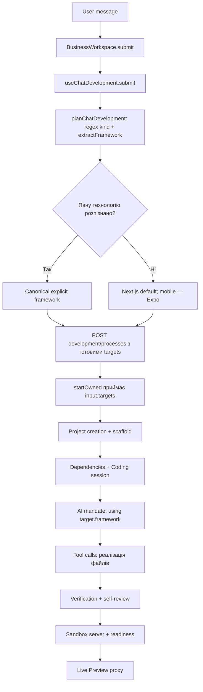

# Аудит Technology Selection у NPATI AI Agent

Дата: 2026-10-22, Europe/Kiev. Git HEAD: `a292a23d3de0af9bbd58346db174fb94fa3ec0ea`. До аудиту робоче дерево було чистим. Код, конфігурацію, deployment і користувацькі проєкти не змінено; створено лише цей звіт.

**Висновок: у наданому запуску Next.js призначено системою до виконання Coding Agent. Основна причина — hardcoded default frontend planner. Сервер приймає готовий target, а модель отримує mandate реалізувати проєкт на вже призначеному Next.js. Порівняння оптимальності стеків у цьому шляху немає.**

Runtime підтримує значно більше технологій. Основна проблема — неузгоджені правила між entry points, вузький semantic contract і fallback, які можуть порушувати прямі обмеження користувача.

**1. Докази конкретного запуску**

Користувач надав [розмову](http://localhost:13001/c/0caf3e31-b3b6-41df-8a80-af9f464ca368). Перевірено read-only SELECT у локальному PostgreSQL і релевантні поля Docker logs. Нових повідомлень/run у цій розмові не створювали.

| Факт | Значення |
|---|---|
| User message | `створи мені інтернет магазин` |
| Conversation ID | `0caf3e31-b3b6-41df-8a80-af9f464ca368` |
| Development Process ID | `a17cf6ce-10c4-4405-a1d7-714a73fed8b8` |
| Project ID | `058cb874-e2ea-46f1-aad5-da3e29bfa8da` |
| Coding Run ID | `53bf1a16-298c-49d2-b342-4ad96788da57` |
| Process createdAt | `2026-10-22T06:50:30.108Z` — 09:50:30 за Києвом |
| Project createdAt | `2026-10-22T06:50:30.635585Z` |
| Run startedAt | `2026-10-22T06:51:09.913Z` |
| Run finishedAt | `2026-10-22T06:57:26.393Z` |
| Project framework / type | `Next.js` / `code_project` |
| Persisted run / build status | `completed` / `ready` |

API logs перед створенням розмови містять `POST /chat/development/processes`, `reqId=req-4x`. У `code_run_states.request_text` збережено:

```text
User request: створи мені інтернет магазин
Your assigned project is Online store (store), using Next.js. Implement ONLY this project's specification; other requested projects have separate workspaces.
Only minimal framework configuration and empty entry points have been prepared.
```

Проєкт створено приблизно за 39 секунд до старту Coding run. Модель отримала готовий стек. Persisted development process також має `framework=Next.js`.

Поточний deployed frontend `/assets/index-DCnKiQhT.js` містить expression `framework:m==="mobile_app"?"Expo":o??"Next.js"` та development endpoint. Запущений `/app/dist/server.js` містить знайдені router prompt, whitelist трьох frameworks і implementation mandate. Це цільова перевірка фрагментів, не повна сертифікація source/image parity.

Первісне HTTP body у перевірених логах не збережено. Його побайтове відтворення не заявляється. Фактичний endpoint, process/run, mandate й deployed код підтверджують механізм. Окремого persisted «чому обрано стек» немає.

[Activity цього run](http://localhost:13001/activity?runId=53bf1a16-298c-49d2-b342-4ad96788da57).

**2. Повний execution flow**



Посилання нижче відносні до цього звіту; зазначено початкові рядки потрібних ділянок.

| Етап | Файл, функція та поведінка |
|---|---|
| Submit | [BusinessWorkspace.tsx](../../apps/web/src/BusinessWorkspace.tsx), фактичний repo path `apps/web/src/BusinessWorkspace.tsx:374`: звичайний текстовий submit без attachments і з пам'яттю спочатку викликає `development.submit()`. Якщо він обробив повідомлення, загальний chat/SSE не виконується. |
| Intent / frontend planning | `apps/web/src/use-chat-development.tsx:100`, `submit()`: викликає `planChatDevelopment(message, projectId)`; близько рядка 136 надсилає `targets` на `/chat/development/processes`. Перед цим не викликає `/chat/development/plan`. |
| Technology selection | `packages/shared/src/chat-development.ts:54`, `planChatDevelopment()`: regex визначає kind, `extractFramework()` — явну технологію. Рядок 85: `kind === "mobile_app" ? "Expo" : requestedFramework ?? "Next.js"`. |
| API | `apps/agent-api/src/chat-development-routes.ts:65`: schema приймає targets як array of object без детальної перевірки framework/constraints. |
| Server planning bypass | `apps/agent-api/src/chat-development-service.ts:238`, `startOwned()`: `input.targets` з непорожнього масиву мають пріоритет над `await this.plan(ctx, input)`. Auth, permissions, flags та admission перевіряються окремо. |
| Creation | `chat-development-service.ts:399`: створення code project без автоматичного DataBackend; рядок 413 передає `target.framework` у preparer. |
| Scaffold | `apps/agent-api/src/project-orchestrator.ts:135`, `prepareCodingWebsite()`: canonicalization, scaffold, framework persistence, PROJECT.md. `project-orchestrator-scaffold.ts:196`, `scaffoldWebsiteProject()`: HTML — порожній workspace; Next — `minimalNextScaffold`; інші відомі frameworks — `createFrameworkScaffold()`. |
| Dependencies / model | `chat-development-service.ts:437`: dependencies preparation. Рядок 454 викликає executor із `createProjectImplementationPrompt()`. `project-creation-prompt.ts:8`: mandate `using target.framework`. |
| Coding | `code-session-run-executor.ts`, `coding-agent-runner.ts`, `coding-agent-prompt-context.ts`: tool loop, verification, self-review. `code-toolchain-detector.ts` читає manifests/Makefile; це detection наявних команд, не аналіз оптимального стеку. |
| Sandbox / build | `project-sandbox-service.ts`, `shared-project-runtime-provider.ts`, `project-preview-service.ts:182`, `buildProject()`: canonical files, ізольований runtime/process/port, install/build. |
| Preview | `code-chat-website.ts:65`, `finishCodeChatWebsite()`: для не-HTML потрібний passed build verification, потім Preview. `project-preview-stack.ts:10`, `detectProjectStack()`: server command із фактичних файлів; `project-preview-service.ts` — HTTP readiness і proxy. |

Шляхи файлів у таблиці рахуються від кореня репозиторію. Runtime не має загальної команди перевести будь-який проєкт на Next.js.

**3. Хто прийняв рішення**

| Компонент | Роль |
|---|---|
| Frontend planner | Первинний hardcoded вибір Next.js, коли extraction не дав технології. |
| Server startOwned | Приймає готовий клієнтський target без повторного technology planning. |
| Scaffold | Матеріалізує вже вибраний framework. |
| Coding model | Реалізує запит усередині призначеного Next.js; не отримує завдання порівняти стеки. |
| Semantic model | Є в інших маршрутах, але не потрібна frontend fast path цього запиту. Її prompt також задає Next.js default. |
| Tool schemas | Не первинна причина; development schema не забезпечує constraint consistency. |
| Coding Runtime / Sandbox | Виконує фактичні commands і Preview; не первинне джерело вибору. |

`buildSystemPrompt()` у `coding-agent-runner-prompt.ts` не вимагає завжди Next.js. `ensureWebsiteAgent()` у `project-orchestrator-scaffold.ts:72` має нейтральну стандартну інструкцію: `Inspect the project files, implement the requested website, and verify the result.` Framework нав'язується раніше — target/scaffold/implementation prompt.

**4. Усі знайдені суттєві defaults і fallback**

Єдиного global framework setting, який керує всіма creation paths, не знайдено. Defaults розподілені й суперечливі.

| Місце | Поведінка |
|---|---|
| `packages/shared/src/chat-development.ts:85` | Blog/store/CRM/company site без explicit framework → Next.js. Kind не змінює стратегії стеку. |
| `apps/agent-api/src/chat-project-intent.ts:20` | Semantic router prompt задає лише `Next.js / HTML/CSS / Expo`. Це JSON-інструкція моделі, не function tool schema. |
| `chat-project-intent.ts:25` | Пряма інструкція: `Default website framework Next.js, native mobile Expo.` |
| `chat-project-intent.ts:125` | Runtime validator дозволяє лише ці три framework names; kind API також відсутній, хоча shared target type має API. |
| `chat-project-intent.ts:63` | Provider error/15s timeout/invalid JSON/низька confidence/invalid targets → deterministic fallback, generic log `chat_project_intent_fallback`. |
| `chat-project-intent.ts:67` | Якщо planner не дав targets, fallback зберігає лише explicit HTML/CSS або mobile Expo; інші frameworks перетворює на Next.js. |
| `chat-development-service.ts:224` | `plan()` повертає semantic targets, якщо вони є; інакше deterministic targets. Немає загального consistency contract intent ↔ target. |
| `chat-stream-routes.ts:184` | Пріоритет canonical decision.framework → prompt extraction → Next.js. Semantic Next.js може перекрити явне Vue у запиті. |
| `project-orchestrator.ts:233` | Legacy default: decision framework → extraction → магазин/store/shop/commerce ? Next.js : HTML/CSS. |
| `project-orchestrator-scaffold.ts:209` | Unknown canonical framework → Next.js scaffold. При цьому `prepareCodingWebsite()` може зберегти невідому назву у metadata. |
| `packages/shared/src/website-schema.ts:9` | WebsiteDocument default `nextjs`. |
| `packages/shared/src/website-renderer.ts:698` | `getWebsiteAdapter()`: static/vite/astro branches, усе інше → NextJsAdapter. |
| `apps/web/src/WebsiteBuilderDashboard.tsx:247` | Manual Builder mapping static/vite/astro, решта → nextjs. |
| `website-editor-support.ts:69`, `WebsiteEditor.tsx:229` | Mock/fallback visual document переважно Next.js, окремо Vite. Це не доказ заміни runtime, але ризик некоректного UI. |
| `website-editor-topbar.tsx:99` | Static badge HTML/CSS, Vite badge VITE, усе інше NEXT.JS, включно з Astro. |
| `project-orchestrator-scaffold.ts:258` | За відсутності framework PROJECT.md каже Vite + React: документаційний fallback, не реальне встановлення Vite. |

Legacy `recordScaffoldFallback()` при malformed delegation працює для вже вибраних Next.js/HTML (`project-orchestrator.ts:494`, `:516`), повідомляючи про незавершену AI-персоналізацію (`project-orchestrator-scaffold.ts:304`). Це fallback виконання, а не universal framework replacement.

`project-preview-stack.ts:71` перевіряє hasNext раніше за інші frameworks, але тільки за наявності dependency/config Next.js. Нерозпізнаний Preview stack отримує static HTTP server, не Next.js.

**5. Обов'язкові тестові сценарії**

Усі вісім точних формулювань виконано через реальні pure functions у Node/tsx без зовнішньої моделі, мережевих writes і створення проєктів. Router fallback перевірено з контрольованою provider error. Semantic validator перевірено з інжектованими JSON responses — це contract probes, не live AI.

Таблиця описує новий текстовий запит без active project/attachments у frontend creation path. Інший контекст може обрати інший entry point.

| Запит | Фактичний planner stack | Джерело | Оцінка |
|---|---|---|---|
| «Створи інтернет-магазин» | Next.js | Hardcoded default, kind store | Кандидат можливий, але оптимальність не оцінюється. Аналогічний фактичний запит користувача підтверджено за run. |
| «Створи блог» | Next.js | Той самий default, kind blog | Тип розпізнано; контентна стратегія стеку відсутня. |
| «Створи корпоративний сайт» | Next.js | Той самий default, kind website | SSR/SSG/CMS/hosting не порівнюються. |
| «Створи CRM» | Next.js | Той самий default, kind crm | Backend/RBAC/persistence не аналізуються до вибору framework. |
| «Створи сайт на Vue» | Vue 3 + Vite | Explicit extraction/mapping | Відповідає стеку; Nuxt не підставляється. |
| «Створи інтернет-магазин на Laravel» | Laravel | Explicit extraction/mapping | Відповідає вибору; install/Preview мають окремий історичний Blocked. |
| «Create an online store using Next.js» | Next.js | Explicit extraction | Відповідає; це не default selection. |
| «Створи простий HTML-сайт без фреймворків» | **Next.js** | Extraction губить HTML → default | **FAIL: суперечить прямій вимозі.** |

Причина HTML FAIL — `packages/shared/src/project-intent.ts:165`, `extractFramework()`: відкидає весь рядок/речення з `без\s`, `не використовуй`, `do not use` тощо. У точному запиті «HTML» і «без» в одному fragment; позитивний HTML зникає разом із забороною. Extraction повертає undefined, planner — Next.js. Окремий deterministic intent classifier для цього формулювання повернув CHAT, хоча planner повернув creation target.

Fallback probes для «Створи блог» і «Створи CRM» також дали `decision.intent=CHAT` одночасно з непорожніми Next.js targets. Frontend fast path використовує targets; серверні entry points можуть поводитися інакше.

Додаткові відтворені дефекти:

| Probe | Факт |
|---|---|
| «Створи сайт без Next.js» | Planner вибирає заборонений Next.js: негативне обмеження не перевіряється перед default. |
| «Створи сайт на PHP» | Planner вибирає Next.js: plain PHP не має extraction mapping, хоча Preview має PHP branches. |
| «Створи проєкт на Vue» + unavailable provider | Decision framework Vue 3 + Vite, але fallback target Next.js: planner не знайшов kind, fallback утратив framework. |
| «Create a project using Nuxt» + unavailable provider | Decision Nuxt, fallback target Next.js з тієї самої причини. |
| Semantic response Vue/Laravel для відповідних явних запитів | Validator відхиляє правильну технологію й переходить у fallback. Для обов'язкових формулювань fallback відновлює explicit framework. |
| Semantic response Next.js для явного Vue/Laravel | Приймається як source=semantic без constraint validation. Серверний шлях може втратити пряму вимогу. |
| Semantic response HTML/CSS для точного HTML-запиту | Приймається. Але звичайний frontend fast path до цього router не доходить. |

Нові повні Chat → model → build → browser E2E для **кожного із восьми сценаріїв — Blocked: у аудитора немає authenticated test session**. Новий preflight `/health` → 200, `/api/auth/me` без сесії → 401. Це не означає, що користувач не залогінений у власному браузері. Існуючий магазин прочитано за persisted evidence, не створено повторно. Старі smoke runs не зараховані як нові тести матриці.

**6. Які технології реально підтримано end-to-end**

`SUPPORTED_PROJECT_FRAMEWORKS` у `packages/shared/src/project-intent.ts:106` містить 17 назв. `canonicalFrameworkName()`/`extractFramework()` розпізнають більшість явних технологій. `project-framework-scaffold.ts:223` має альтернативні builders; Next.js — `project-minimal-scaffold.ts:41`; Expo — mobile scaffold.

Наявність enum/detector не дорівнює успішному Chat E2E або production readiness.

| Технології | Реалізація | Докази та межі |
|---|---|---|
| Next.js | Selection, Next/React/TS scaffold, build, server detection, Preview | Поточний існуючий магазин: persisted completed run + ready build. Нової browser QA цього сайта не виконували. |
| React + Vite; Vue 3 + Vite | Explicit mapping, власні builders, manifests/build/Preview | Історичні локальні Chat create/edit/browser QA PASS. |
| Nuxt; SvelteKit; Astro; Angular; Remix / React Router Framework | Framework builders і server commands | Історичні Chat create/edit/browser QA PASS; попередній звіт має окремі SSR докази. |
| Node.js через Express/Fastify/NestJS | Backend mapping, builders/build/server | Історичні Chat create/edit/browser QA PASS. |
| Python через FastAPI/Django/Flask | requirements, venv/pip, Makefile, server detection | Історичні Chat create/edit/browser QA PASS. |
| Laravel | Mapping, composer/artisan/Makefile, install/server branches | **BLOCKED**: Composer failures; application build/runtime/Preview/edit не досягнуті. |
| HTML/CSS/JS | Empty workspace, static HTTP Preview | Історичні create/edit/browser QA PASS. Компіляторний build — NOT TESTED, бо його немає. Точне формулювання цієї матриці має routing FAIL. |
| Plain PHP | Preview знає composer/artisan/index.php і PHP server | Повний selection/scaffold/E2E не підтверджено; explicit PHP зараз губиться. |
| Expo / React Native | Mobile scaffold і Expo Web export detection | Не входить до попередньої 15-framework матриці; native mobile E2E не підтверджено цим аудитом. |
| Go/Rust/Java та інші | Toolchain detector для Go/Cargo/Maven/Gradle; sandbox image definitions | Це частини Coding Runtime, не доказ автоматичного creation → HTTP Live Preview. |

Історичне джерело: [Framework Deployment Chat E2E](../coding-agent/framework-deployment-e2e-report.md), 20–21 жовтня 2026: 14 PASS і Laravel BLOCKED. У цьому аудиті прочитані також summaries усіх 15 framework JSON у `artifacts/framework-chat-e2e-current/`, включно з `vue-3-vite.json`. Кожен screenshot/terminal command повторно не перевіряли. Це історичні докази, не нові live прогони.

Laravel attempts включають allowlist CONNECT 403, advisory blocking старої версії та пізніші Laravel 13 Composer connect timeout/exit 100. Не можна звести це до «PHP не підтримується» або «достатньо відкрити host». Залишалася перевірка APP_KEY після install. Див. розділ «Laravel: точна межа підтвердження» попереднього звіту. Policies не послаблювалися.

`project-preview-service.ts:182`, `buildProject()` уже має npm/pnpm/yarn/bun install/build; без package.json — requirements/venv/pip або composer + Makefile. `project-preview-stack.ts:10` має окремі реальні server commands. Новий паралельний Runtime для виправлення вибору не потрібний.

Production deployment, платежі, реальна обробка замовлень, навантаження та повнота commerce backend не сертифікувалися. Відповідь існуючого run прямо описує browser-local cart і відсутність реальних оплат: слово «магазин» не гарантує production commerce backend.

**7. Website Builder, prompts і шаблони**

- Manual Builder має HTML/CSS, Next.js, Vite, Astro у `apps/web/src/website-builder-constants.tsx:87`. Dashboard default — перший HTML/CSS (`WebsiteBuilderDashboard.tsx:65`). Твердження «весь UI завжди Next.js» неправильне.
- Visual WebsiteDocument schema обмежена nextjs/vite/static/astro. Вона вужча за Coding Runtime catalog; окремих Vue/Nuxt/Laravel visual adapters немає.
- `getWebsiteAdapter()` за невідомого framework обирає Next.js. ViteAdapter/AstroAdapter у `website-renderer-adapters.ts` частково використовують NextJsAdapter, змінюючи manifest/entrypoints. Сам виклик NextJsAdapter не доводить Next.js runtime: потрібен аналіз generated manifest і detector.
- `minimalNextScaffold()`/`finalizeMinimalScaffold()` залишають мінімальні entrypoints, прибираючи demo UI. Модель справді пише реалізацію; це не лише видача готового дизайну. Але framework призначений до моделі.
- Next.js маркетингові фрази в App.tsx, website-component-registry.ts і builder copy не є алгоритмом вибору.
- `template=hosting/landing` у поточному `scaffoldWebsiteProject()` не керує framework selection. Гілка залежить від canonical framework.
- У перевірених Coding Agent/Website Builder prompts не знайдено окремого обов'язкового порівняння технологій перед scaffold. Пряма установка Next.js підтверджена саме в semantic router та deterministic planner/defaults.

**8. Аналіз вимог і передача Planner → Coding Agent**

Frontend визначає website/blog/store/crm/mobile_app/api через keyword/regex. Для немобільних видів без explicit framework результат однаковий. SaaS/admin panel/dashboard та API без названої технології не мають тут окремої стратегії. Semantic router розуміє ширші формулювання, але його framework contract вузький.

Не знайдено обов'язкового перед-scaffold аналізу SEO, SSR/SSG/SPA, CMS, checkout/payments, persistence/auth/RBAC, integrations, hosting, команди, бюджету чи existing backend. Немає comparison candidates або structured rationale. Confidence semantic router — впевненість у intent, не оцінка оптимальності стеку.

Якщо коректний target дістався `ChatDevelopmentService.run()`, зв'язка target.framework → prepareCodingWebsite → implementation prompt пряма. Vue/Laravel там не замінюються Next.js безумовно. Точки втрати раніше: frontend default, semantic contract/відсутність constraint validation, fallback targets і unknown-framework scaffold.

Наявні `code.plan.propose`/`code.plan.update` у `apps/agent-api/src/code-plan-tool.ts` зберігають session plan/todos; validatePlanBody залишає files/steps/risks/testStrategy. Це не типізоване technology decision перед scaffold: у звичайному creation run каркас уже існує до виклику моделі. Не потрібно дублювати наявну систему планів.

**9. Activity & Run Trace**

Framework видно в process/project metadata, mandate й setup title `Preparing minimal <framework> configuration` (`chat-development-service.ts:410`, actor System). Monitoring уже підтримує preparation до model run (`coding_setup`, `code-monitor-routes.ts:41`), tools, verification та terminal results.

Водночас немає обов'язкового technology-selection event із provenance user_explicit/policy_default/model_decision/fallback, причиною, constraints і rejected alternatives. Resolver повертає source=semantic/deterministic, але це не збережений наскрізний technology decision. Поле framework у process — лише результат; planning stage або model narration не замінюють audit record.

Activity може показати Next.js, але не пояснити перевірювано, хто його призначив. У цьому випадку причина встановлена кореляцією source/logs/mandate. Browser QA Activity UI в цьому аудиті не виконувалася.

**10. Перевірки та обмеження**

Виконано read-only source/deployed-fragment/DB/log аудит, pure-function probes восьми запитів і додаткових edge cases, а також наявні ізольовані tests:

```text
node node_modules/vitest/vitest.mjs run tests/framework-deployment-support.test.ts tests/chat-semantic-project-intent.test.ts tests/project-intent-router.test.ts tests/project-creation-pipeline.test.ts tests/coding-agent-chat-website.test.ts tests/website-builder-schema.test.ts --maxWorkers=1
```

**153 tests: 148 passed, 5 failed; 5 files passed, 1 failed; exit 1; 128.01 s.** Framework support 44/44, semantic routing 38/38, creation pipeline 18/18, code chat website 23/23, builder schema 7/7; project intent router 18/23.

П'ять failures у `tests/project-intent-router.test.ts`:

1. `stops before AI on a database bootstrap failure and retries the same project`: expected rejection, отримано resolved result.
2. `creates a website builder for a default company and never assigns file tools to the coordinator`: expected build success, отримано failed.
3. `builds the prepared Next.js website when delegation JSON remains malformed`: Project file not found.
4. `creates a plain HTML hosting site without a sandbox when no framework is requested`: expected completed, отримано failed.
5. `creates an HTML blog for the exact chat request`: expected success, отримано failed.

Частина expectations стосується старих scaffold/automatic-data contracts, тоді як поточна реалізація має minimal scaffold і optional DB. Root cause кожного failure окремо не встановлювався; fixtures/assertions не змінювали. Загальний PASS не заявляється; ці failures не підміняються доказом production інцидентів.

Тести працювали з локальними fixtures/mocks. Нові повні live E2E Blocked через відсутність authenticated session аудитора. Старий Step 10 не використовувався як доказ актуального auth state — виконано новий preflight. Signing secrets, ручні JWT й чужий browser state не використовувалися. Preview bearer URLs до звіту не внесено.

**11. Відповіді на підсумкові питання**

1. **Чому Next.js для магазина?** Extraction не знаходить технології, frontend planner призначає Next.js через `??`, сервер приймає target й передає моделі готовий mandate. Для наданої розмови це підтверджено.
2. **AI чи hardcoded logic?** У цьому запуску — hardcoded selection до моделі. Semantic route має AI-класифікацію, але теж Next.js default і whitelist лише трьох frameworks.
3. **Чи може агент обирати оптимальний стек?** Може виконувати багато явних технологій. Надійного загального аналізу оптимальності стеку за вимогами зараз немає.
4. **Що реально end-to-end?** Історичні локальні create/edit/Preview докази для 14 альтернативних web/backend/static стеків; Next.js — поточний persisted run. Laravel Blocked; plain PHP/native Expo/інші мови не можна вважати перевіреними за одним enum/detector.
5. **Приховані обмеження?** Client selection bypass, semantic whitelist, втрата negation/explicit framework у fallback, unknown→Next scaffold, вузькі visual adapters, різні defaults і відсутність decision provenance в Activity.
6. **Що змінити?** Один authoritative server-side decision contract, обов'язкові user constraints, requirements/capability analysis перед scaffold, видиме rationale і заборона тихої заміни стеку.

**12. План покращення — нічого не реалізовано**

P0: збереження прямих вимог.

1. Використати існуючі `/chat/development/plan` і `ChatDevelopmentService.plan()` як авторитетний серверний шлях. Клієнтський target не повинен обходити перевірку constraints; auth/tenant/admission checks зберегти.
2. Розширити existing planning contract типізованим technology decision: selected stack, project kind, positive/negative constraints, provenance, short rationale, capability evidence, version/id. Використати наявні canonical names/builders/detectors, не дублювати registry.
3. Виправити extraction: розділяти позитивні й негативні технології замість видалення цілого речення. Заборона Next.js має виключати його з defaults. Explicit HTML/Vue/Laravel мають зберігатися або давати видиму compatibility error.
4. Узгодити semantic prompt/validator з existing supported catalog і kind API. Schema-valid Next.js у відповідь на explicit Vue має відхилятися. Не використовувати Next.js як заміну unsupported explicit стеку.
5. У fallback зберігати framework із decision.targetDetails. Unknown stack має давати структуровану помилку, а не Next scaffold під іншою назвою.

P1: обґрунтований вибір до scaffold.

6. Передавати planner capability matrix existing scaffold/install/verify/Preview branches і поточного readiness/known Blocked states. Розділяти source support та готовність середовища. Повторно використати readiness/runtime механізми.
7. Оцінювати SEO/content/SSR/SSG/SPA, persistence/auth/RBAC, integrations/payments, existing repo/backend, hosting і user preferences. Модель пропонує candidate/rationale; deterministic checks перевіряють constraints і здійсненність.
8. Уточнювати лише суттєву неоднозначність: demo storefront чи реальні платежі/замовлення, CMS чи static content тощо. Не вимагати framework question від кожного користувача. Policy default має бути явно названий із assumptions.
9. Передавати один decision id/version через creation, scaffold, Coding Agent і final verification. Existing manifest detector перевіряє фактичний стек. Зміна рішення — видима нова версія, не тиха заміна.

Приклад майбутньої політики, не опис поточної: HTML/Astro для простого контентного сайта; React/Vue з потрібним backend для authenticated CRM; Next/Nuxt/Laravel для магазина залежно від SEO, checkout, data і hosting; Node/Python/Laravel для API залежно від integrations. Тип проєкту сам по собі не повинен означати один обов'язковий framework.

P1: видимість рішення.

10. Додати event у існуючі Activity/Run Trace: actor, provenance, chosen framework, коротка причина, constraints, readiness і fallback reason. Rule selection позначати System, не вигадувати AI planning. Зберігати decision summary, не прихований chain-of-thought.
11. Узгодити Builder defaults, unsupported adapters, mock documents і badges. Не показувати Astro як NEXT.JS; не обіцяти visual adapter для Vue/Laravel без реалізації.

P2: перевірка результату.

12. Розширити наявні routing/creation/framework suites: усі вісім точних запитів у UI і server paths, UA/EN, negation, provider timeout/invalid result, Vue/Nuxt project без слова «сайт», plain PHP/unsupported stack, existing-project edits. Перевіряти consistent decision → metadata → manifest → actual Preview.
13. Після штатної test-session auth виконати live матрицю на ізольованих test projects без production. Для unspecified стеку перевіряти rationale/constraints/capabilities, а не «завжди Next.js». Окремо розібрати п'ять regression failures без послаблення assertions заради зеленого статусу.
14. Laravel завершити окремим install/build/runtime/health/Preview/edit тестом після усунення фактичних Composer blockers. Go/Rust/Java/plain PHP/native mobile оголошувати E2E лише після повних відповідних доказів.

Критерій завершення: прямі технологічні вимоги не губляться; стек обирається за перевіреними вимогами й можливостями; Activity пояснює джерело рішення. Жоден пункт плану в цьому аудиті не реалізовано.
