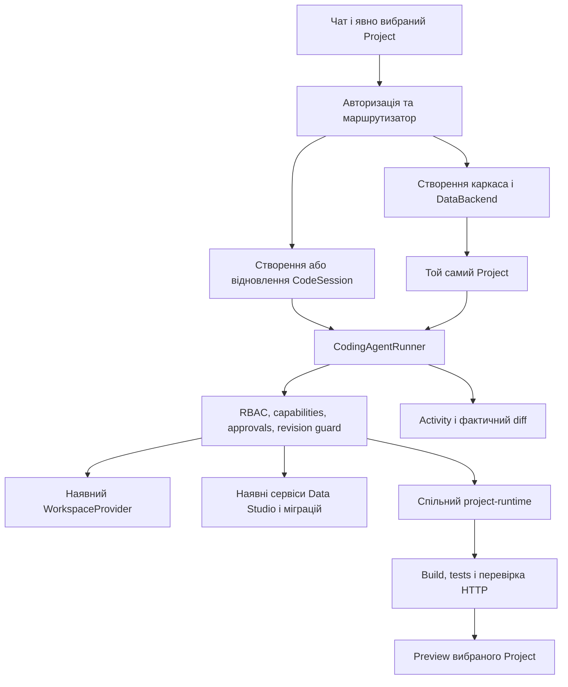

# Створення сайта через чат, база даних і підключення Code

Дата: 09.10.2026. Звіт за поточним кодом локального проєкту. Це аналіз; зміни поведінки системи в межах цього звіту не виконувалися.

## 1. Основний висновок

Створення Next.js-магазину та підключення його DataBackend зараз реалізовано через Website Builder і проєктних агентів компанії. Окремий цикл Coding Agent `Code` у звичайному чаті допускає лише проєкти типу `code_project`. Створений сайт має тип `website`, тому до цього циклу не потрапляє.

Включення прапорців на `/settings/code` не прибирає це обмеження. Встановлювати ще одного агента або Docker-контейнер усередині сайта не потрібно.

Це суперечить цільовій архітектурі [PLAN.md](PLAN.md), розділу «Перевикористання Website Builder»:

> Project, Workspace, Sandbox, Files, Terminal, Git, Checkpoints, Preview розширюються, а не дублюються. Website Builder стає окремим випадком code-проєкту.

Отже, проблема не лише в налаштуваннях: між реалізованими підсистемами залишилося обмеження маршрутизації та неповне підключення.

## 2. Які компоненти виконують роботу

| Компонент | Фактична роль |
|---|---|
| Чат, `BusinessWorkspace.tsx` | Надсилає повідомлення, company/project context; показує прогрес, результат і Preview. |
| Agent API, `app.ts` | Авторизує користувача, визначає контекст, маршрутизує запит між Code, Website Builder та іншими сценаріями. |
| `ProjectOrchestrator` | Створює проєкт і каркас, підключає дані, запускає проєктних агентів, координує перевірку й Preview. |
| Website Builder / проєктні агенти | Отримують запит та інструменти `project.*`; працюють із файлами і, за дозволами, Data Studio. |
| `CodingAgentRunner` | Окремий цикл роботи моделі з інструментами `code.*`, сесією, політиками й Activity. |
| `WorkspaceProvider` | Надає доступ до канонічних файлів проєкту. У поточній композиції використовується `MountedWorkspaceProvider`. |
| `npati-project-runtime` | Спільний контейнер для команд, залежностей, build і процесів Preview різних managed-проєктів. |
| Data Studio / Project API | Бази проєктів, схема, міграції, дані, авторизація покупців, SDK та правила доступу. |

`Code` тут означає Coding Agent NPATI на підключеній AI-моделі. Саме слово «Code» не означає встановлений OpenAI Codex CLI і не вибирає автоматично модель OpenAI.

## 3. Як зараз створюється магазин через чат

Запит: «Створи тестовий сайт інтернет магазин на Next.js, запусти build і Live Preview».

1. Чат визначає, що це новий проєкт. Контекст попереднього сайта не повинен перетворювати цей запит на редагування старого.
2. API перевіряє авторизацію та визначає компанію й намір створення сайта.
3. `ProjectOrchestrator` створює запис Project, його назву, тип і framework. Для цього сценарію тип — `website`, framework — Next.js.
4. Створюється готовий каркас: `package.json`, Next.js App Router, layout, CSS, `website.config.json`, компоненти відображення. Повторний `create-next-app` для такого каркаса не потрібний.
5. Створюється `PROJECT.md` зі спільним контекстом проєкту.
6. Для нового Next.js-сайта викликається підготовка Data Studio. Магазин без доступного сервісу даних завершується помилкою, а не удаваним успіхом.
7. Проєктні агенти отримують запит та доступні інструменти для зміни файлів. Цей етап зараз проходить через Website Builder / Company runtime, а не через `CodingAgentRunner`.
8. Система готує залежності, запускає production build і Preview. У підтримуваних випадках залежності беруться з підготовленого набору runtime; інші версії потребують звичайного встановлення.
9. Картка в чаті відображає фактичний стан проєкту й build. Успішна відповідь коротка; технічне есе моделі не слугує підтвердженням внесених змін.

### Де зберігається сайт

Канонічні файли зберігає WorkspaceProvider на постійному томі API. Runtime отримує робочу копію в `/projects/<projectId>`, запускає окремий процес із власним портом, env і логами. Новий managed-сайт не створює окремі sandbox/proxy Docker-контейнери в спільному self-hosted режимі.

Preview проходить через web → API → runtime → порт потрібного проєкту. Це середовище розробки, не автоматична публікація production-сайта.

## 4. Як створюється база і підключається до сайта

Основний шлях — [`website-bootstrap.ts`](../../apps/agent-api/src/data-studio/website-bootstrap.ts).

1. Перевіряється публічна адреса Project API — `NPATI_PROJECT_API_PUBLIC_URL`.
2. Якщо сайт ще не має `dataBackendId`, створюється DataBackend і прикріплюється до **цього самого Project**.
3. `DataBackendService` provision-ить середовища `dev` і `prod`. Це бази/ролі на спільному PostgreSQL проєктів; створення DataBackend не додає PostgreSQL-контейнер.
4. Bootstrap сайта перевіряє й готує **dev-схему**. Готовність dev не означає, що всі зміни вже застосовані до prod.
5. Для запиту, розпізнаного як магазин, застосовується шаблон `ecommerce`. Частково створена схема магазину зупиняє bootstrap і потребує ремонту, замість безконтрольного повторного створення таблиць.
6. Створюються таблиці звернень і форм, ініціалізується авторизація кінцевих користувачів, налаштовуються CORS origins.
7. У workspace доставляється SDK, а потім створюються клієнтські компоненти й конфігурація з публічним ключем Project API.

### Дані магазину

| Таблиця | Призначення |
|---|---|
| `categories` | Категорії товарів. |
| `products` | Товари: `title`, `slug`, `description`, `price`, `category_id`, `is_active`. |
| `product_variants` | Варіанти товару, SKU, ціна й залишок. |
| `carts`, `cart_items` | Кошики та їхні позиції. |
| `orders`, `order_items` | Замовлення та позиції замовлення. |
| `addresses` | Адреси покупців. |
| `contact_messages` | Звернення через контактну форму. |
| `form_submissions` | Універсальні заявки з назвою форми та JSON payload. |

Auth-сервіс додатково готує свою структуру користувачів і сесій. Покупець сайта та адміністратор установки NPATI — різні контексти авторизації.

Каталог читає Project API через SDK. Кошик використовує сесію покупця; приватні записи захищаються правилами доступу/RLS. Клієнтський код не повинен отримувати `DATABASE_URL`, серверний секретний ключ або прямий адміністративний доступ до PostgreSQL.

Для порожнього тестового магазину bootstrap додає демонстраційний товар і варіант у справжню dev-базу. Це тестові дані, не повноцінний товарний каталог.

### Форми й довільні поля

Зараз автоматично підготовлені контактна та універсальна форми. Це **не доказ**, що система аналізує кожну довільну форму згенерованого сайта й автоматично створює для неї окрему таблицю з усіма полями.

Для додаткових структур є інструменти `project.data.schema.inspect` та `project.data.schema.apply`. Коректний сценарій: прочитати схему → додати потрібні поля/таблиці міграцією → змінити компонент форми → перевірити фактичне збереження. Зміна лише JSX-форми не змінює схему бази.

## 5. Чому Code не редагує цей сайт

| Місце | Поточне обмеження | Наслідок |
|---|---|---|
| [`code-intents.ts`](../../packages/shared/src/code-intents.ts) | Веб- і мобільні проєкти виключені з code context; mapping проєктних намірів також розділяє ці сценарії. | Намір зміни сайта не стає Code-завданням лише через включений flag. |
| [`code-intent-routing.ts`](../../apps/agent-api/src/code-intent-routing.ts), `resolveChatCodeIntent` | Якщо `projectKind !== "code_project"`, повертається звичайна маршрутизація чату. | Чат обходить `CodingAgentRunner` для сайта. |
| [`app.ts`](../../apps/agent-api/src/app.ts) | Resolver окремого Code intent endpoint також допускає лише `code_project`. | Обхід через інший endpoint сам по собі проблему не вирішить. |
| [`code-service.ts`](../../apps/agent-api/src/code-service.ts), `listProjects` | Список фільтрується за `type === "code_project"`. | Створений сайт не з’являється як звичайний Code-проєкт у налаштуваннях. |
| Чатова гілка Code в `app.ts` | Після маршрутизації потрібна придатна CodeSession; без неї повертається уточнення. | Сам вибір сайта ще не забезпечує запуск циклу Code. |
| Інструменти Code | Перевірений реєстр `code.*` не містить підключення `project.data.*` для схеми й даних сайта. | Редагування файлів через Code не означає доступу до міграцій Data Studio. |

Важливе уточнення: `CodeService.createSession` і перевірений PostgreSQL store не містять простої заборони створити сесію для будь-якого іншого типу Project. Не можна робити висновок, що вся модель сесій уже несумісна із сайтами. Підтверджені блокери — маршрутизатори, UI-список, підготовка контексту/сесії та зв’язок інструментів. Решту адаптерів і політик треба перевірити перед розширенням підтримки.

## 6. Що користувач може перевірити зараз

### Редагування створеного сайта

У тій самій розмові зі збереженим активним сайтом:

> У цьому магазині зроби світлий фон, сині кнопки й заголовок «Мій магазин». Збережи зміни, запусти build і Live Preview.

Це зараз тест Website Builder / проєктних агентів. Потрібно перевірити змінені файли в Changes, результат build та реальний Preview. Відповідь моделі «я змінив» без diff і фактичної зміни вигляду недостатня.

### Окремий Coding Agent

На `/settings/code` створити код-проєкт, сесію `auto_edit`, відкрити її через **Open in chat** й попросити створити `README.md` з унікальним текстом `CODE_TEST_001`. Далі перевірити файл, Changes та інструментальні події в Activity.

Цей тест доводитиме запуск Code в окремому код-проєкті. Він не доводитиме інтеграцію Code зі створеним магазином. Новий живий запуск Code для сайта в межах цього аналізу не виконувався.

## 7. Як правильно з’єднати підсистеми

Ціль: **один Project, один канонічний workspace, один прикріплений DataBackend; різні режими та агенти працюють із тими самими ресурсами**.

Рекомендована послідовність реалізації:

1. **Контекст.** Уніфікувати активні `companyId/projectId/sessionId`, використовуючи наявне зберігання. Перевіряти власника, доступ і відповідність сесії проєкту на сервері. Не вибирати випадковий останній проєкт іншої розмови.
2. **Допуск типів.** Узгоджено розширити classifier, обидва Code routers, resolver і UI на підтримувані managed website/mobile/code проєкти. Не міняти тип сайта на `code_project` лише для обходу перевірки.
3. **Сесії.** Для запиту на зміну конкретного сайта створювати або відновлювати сесію цього Project з дозволеним режимом. Для аналізу зберігати read-only режим; включений flag не означає дозвіл на всі операції.
4. **Файли й виконання.** Підключити наявні WorkspaceProvider, terminal, Git, checkpoints і shared runtime до Code без другої копії сайта як окремого проєкту. Перевірити фактичні адаптери й блокування конкурентних запусків двох агентних циклів.
5. **Дизайн.** Узгодити зміни `website.config.json`, React-компонентів і Visual Builder. Не замінювати авторський дизайн bootstrap-компонентом при повторній підготовці БД.
6. **Дані.** Підключити до Code наявні Data Studio capabilities через серверний адаптер. Прив’язати операції до `projectId → dataBackendId → environment`; використати існуючі міграції, validation і approvals. Не давати моделі прямий суперкористувацький SQL-доступ.
7. **Перевірка.** Після змін запускати необхідні build/tests і оновлювати Preview саме цього проєкту. Не повідомляти про готовність лише на підставі тексту моделі чи запущеного процесу.
8. **Захист.** Зберегти RBAC, revision guard, isolation, secret policy, Activity і відмінність dev/prod. Руйнування схеми, зміна політик доступу та production-операції мають проходити відповідні чинні погодження.

## 8. Критерії, за якими приймати інтеграцію

| Сценарій | Потрібний доказ |
|---|---|
| Створити сайт, потім змінити його дизайн через Code | Той самий `projectId`; Code run з виконаними файловими інструментами; diff, успішна перевірка і змінений Preview. |
| Додати поле товару | Схема спочатку прочитана; застосована dev-міграція; поле відображене в UI; значення реально збережене. |
| Додати нову форму | Таблиця/поля та policy підготовлені; запис форми з’явився в Data Studio; немає удаваного успіху. |
| Перемкнутися з магазина A на блог B | Запуск явно прив’язаний до B; файли й база A не змінені. |
| Два одночасні редагування | Конфлікт revision або контрольований порядок; немає тихого перезапису. |
| Restart Preview сайта A | Процеси B продовжують працювати; число основних контейнерів не збільшується через перезапуск. |
| Вимкнути Code для компанії | Кодова гілка справді не запускається; UI й Activity зрозуміло показують дозволений шлях. |
| Заборонена або production-операція | Deny/approval за чинною політикою; відсутність змін до дозволу. |

## 9. Межі цього звіту

Це аналіз конкретного інтеграційного шляху, а не повна сертифікація всіх кроків трьох планів. Попередня браузерна перевірка створення магазина описана в [звіті про магазин і коротку відповідь](../website-builder/2026-10-09-storefront-and-short-chat.md). Вона підтвердила Next.js build, Preview та базові переходи, але не інтеграцію Code, оплату чи повний checkout.

Також у dev Preview залишається обмеження WebSocket HMR, зафіксоване в тому звіті. Звичайний перехід між сторінками й повторний запуск Preview не доводять автоматичного оновлення після кожного редагування.

Основні джерела: [ProjectOrchestrator](../../apps/agent-api/src/project-orchestrator.ts), [композиція API](../../apps/agent-api/src/app.ts), [каркас сайта](../../apps/agent-api/src/website-data-scaffold.ts), [магазин](../../apps/agent-api/src/commerce-presentation.ts), [DataBackendService](../../apps/agent-api/src/data-studio/service.ts), [шаблони даних](../../packages/shared/src/project-data-templates.ts), [Code intent routing](../../apps/agent-api/src/code-intent-routing.ts), [CodeService](../../apps/agent-api/src/code-service.ts), [CodingAgentRunner](../../apps/agent-api/src/coding-agent-runner.ts), [Code tool runtime](../../apps/agent-api/src/code-tool-runtime.ts), [активний Code-контекст](../../apps/agent-api/src/code-active-context-store.ts).
