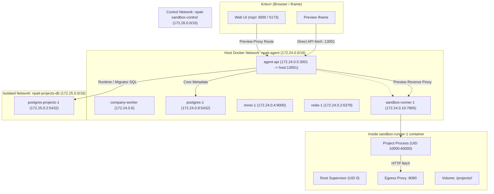

# NPATI Website Integration — Stage 1 Audit Report

- **Дата аудиту:** 2026-10-17
- **Режим:** Лише аудит (БЕЗ змін коду, конфігурацій, схем БД чи робочих даних)
- **Стан Git:** Commit `2bd5ff6 Coding Agent-3`, branch `main`, робоча директорія чиста (крім незбережених правок у web UI та untracked `docs/integration/`)
- **Контейнери в роботі:** 11 контейнерів стеку `npati-isolated-source-20261011` підняті та здорові (agent-api, company-worker, sandbox-runner, minio, omniroute, postgres, postgres-projects, redis, crawler, browser-use, pg-proxy)

---

## 1. Матриця вимог (PLAN.md Coding Agent та Data Studio)

| ID / Джерело | Вимога | Статус | Доказ (файл, функція, тест) |
|---|---|---|---|
| **C1** | Workspace & Code Project Foundation | Реалізовано | `apps/agent-api/src/project-workspace.ts`, `apps/agent-api/src/code-project-service.ts`, `tests/code-project-workspace.test.ts` |
| **C1a/C1b** | Staged rollout, feature flags, sandbox supply-chain | Реалізовано | `apps/agent-api/src/code-feature-flags.ts`, `apps/agent-api/src/sandbox-image-policy.ts`, 180 тестів у security gate |
| **C1c** | Tamper-evident audit log (Merkle/SHA-256) | Реалізовано | `apps/agent-api/src/code-audit-log.ts`, `tests/code-audit-log.test.ts` |
| **C2** | Read-only Tools: fs.list, fs.read, fs.search, fs.tree, symlink safe | Реалізовано | `apps/agent-api/src/code-tools-fs.ts`, `apps/agent-api/src/code-tools-path.ts:normalizeWorkspacePath,assertSafeSymlink` |
| **C3** | Write tools: fs.write, fs.edit, fs.patch, diff, checkpoints | Реалізовано | `apps/agent-api/src/code-tools-write.ts`, `apps/agent-api/src/code-checkpoints.ts`, `tests/code-tools-write.test.ts` |
| **C4** | Terminal, execution, background processes, command verification | Реалізовано | `apps/agent-api/src/code-tools-terminal.ts`, `apps/agent-api/src/code-terminal-policy.ts` |
| **C4a/C4b** | Supply-chain security, egress enforcement & proxy | Частково / Є дефект | `apps/agent-api/src/sandbox-egress-proxy.mjs`. Egress proxy фільтрує 8080 для UID 10000-60000, але UID 0 / 65534 має прямий доступ до внутрішніх сервісів NPATI Core |
| **C5/C5a/C5b** | Policy engine, RBAC, Approvals, Provider Data Policy | Реалізовано | `apps/agent-api/src/code-policy-engine.ts`, `apps/agent-api/src/provider-data-policy.ts` |
| **C6/C6a/C6b** | CodingAgentRunner, recovery, rollback, execution snapshots | Реалізовано | `apps/agent-api/src/code-session-run-executor.ts`, `apps/agent-api/src/code-session-recovery.ts` |
| **C7** | Code Workspace UI | Реалізовано | `apps/web/src/WebsiteEditor.tsx`, `apps/web/src/WebsiteBuilderDashboard.tsx` |
| **G1 / R1** | Security Gate Phase 1 & Rollout Readiness | Реалізовано на рівні коду | 180 suite / 2667 passing unit tests |
| **C8–C15** | Async harness, instructions, PR, eval corpus | Реалізовано | `docs/coding-agent/current-state.md` (2026-10-17 checkpoint: 1840 verified) |
| **D0** | Data Studio & Project Auth Audit | Реалізовано | `docs/data-studio/00-audit.md` |
| **D1** | postgres-projects, DatabaseProvisioner, DataProvider, migrations | Реалізовано | `apps/agent-api/src/data-studio/provisioner.ts`, `migration-engine.ts`, `postgres-projects:5432` |
| **D2** | Data Studio UI (Collections, Schema Editor, Row CRUD) | Реалізовано | `apps/web/src/DataStudioPage.tsx`, `apps/agent-api/src/data-studio/studio-service.ts` |
| **D3** | Agent Capabilities (schema, rows, templates, migrations) | Реалізовано | 10 capabilities у `project-data-capabilities.ts`, `agent-data-service.ts` |
| **D4** | Project Auth (end-user tables, scrypt, Ed25519 JWT, RLS compiler, GDPR) | Реалізовано | `apps/agent-api/src/data-studio/auth-service.ts`, `tests/data-studio-project-auth.test.ts` (19/19 pass) |
| **D5** | Project API Gateway, SDK, Keys, Sandbox wiring | Не працює в браузері (Дефект) | `apps/agent-api/src/data-studio/gateway-routes.ts`, `packages/project-client`. В реальному браузері ламається через CORS розбіжність ключів |
| **D6** | Mobile App Project Type (Expo Web preview, deep links) | Реалізовано | `packages/shared/src/mobile-app-template.ts`, `tests/data-studio-mobile-app.test.ts` |
| **D7** | Environments (dev/prod), Promote, Backups, Quotas | Реалізовано в коді | `apps/agent-api/src/data-studio/promote-service.ts`, `backup-service.ts`, `quota-service.ts` |

---

## 2. Фактична архітектура та межі довіри



### Детальні характеристики компонентів:
1. **Sandbox Runner (`sandbox-runner-1`, IP 172.24.0.10 / 172.26.0.2):**
   - **Credentials:** Має `NPATI_SANDBOX_RUNNER_SECRET`. Жодних паролів БД (ні Core, ні Projects) не має.
   - **Mounts:** `project-runtime-workspaces` -> `/projects`, `project-runtime-state` -> `/runtime-state`.
   - **Мережі:** `npati-agent` (172.24.0.0/16) та `npati-sandbox-control` (172.26.0.0/16).
   - **Фактична доступність з контейнера:**
     - Supervisor (UID 0) та `nobody` (UID 65534) **мають прямий доступ** до порту 5432 Core PostgreSQL (`172.24.0.8`), MinIO (`172.24.0.4:9000`), Redis (`172.24.0.2:6379`). (Перевірено реальною командою `nc -zv`).
     - Процеси проєкту (UID 10000-60000) блокуються `iptables` і можуть звертатися лише до `127.0.0.1:8080` (egress proxy).
     - Мережа `npati-projects-db` (`172.25.0.2`) з `sandbox-runner` **НЕдоступна** (timeout).

2. **Shared Sandbox:**
   - Робочий каталог: `/projects/<companyId>/<projectId>`.
   - Окремі UID на проєкт, виділені порти (3001+).

3. **MinIO (`minio-1`, IP 172.24.0.4):**
   - **Credentials:** `MINIO_ROOT_USER=validation-admin`, `MINIO_SECRET_KEY=ce8f...` (доступні в `agent-api` та `company-worker`).
   - **Бакетна структура:** `npati-chat-files`, `npati-company-knowledge`, `npati-generated-media`, `npati-exports`.
   - **Підтримка сайтів:** **ВІДСУТНЯ**. Жодного бакету або префіксу для сайтів немає.

4. **Projects PostgreSQL (`postgres-projects-1`, IP 172.25.0.2):**
   - **Мережа:** Тільки `npati-projects-db` (172.25.0.0/16).
   - **Credentials:** `npati_projects_admin` / пароль у Core env.
   - **Ролі:** На кожен бекенд створюються `db_<id>_dev_m` (migrator) та `db_<id>_dev_r` (runtime, no superuser, RLS enforced).
   - **Доступ:** Доступний ТІЛЬКИ з контейнера `agent-api`. З sandbox та worker маршруту немає.

5. **NPATI Core PostgreSQL (`postgres-1`, IP 172.24.0.8):**
   - Зберігає метадані платформи (проекти, компанії, data_backends, secrets, users, audit logs).
   - Напряму ізольований від кінцевих користувачів створених сайтів.

6. **Agent API (`agent-api-1`, IP 172.24.0.5, 172.25.0.3, 172.26.0.4):**
   - Єдиний компонент, підключений до всіх трьох мереж. Виступає шлюзом між користувачами, AI-агентом, Core DB та Projects DB.

7. **Preview Proxy (`project-preview-service.ts`):**
   - Проксує запити від Web UI до dev-сервера в sandbox runner за підписаним токеном.
   - **Критична знахідка:** Вирізає `Set-Cookie`, `Cookie`, `Authorization`.

8. **Data Studio API Gateway (`gateway-routes.ts`):**
   - Публічний шлюз `/v1/projects/:projectId/...`.
   - Аутентифікація за `X-Project-Key` (publishable/secret) + Bearer JWT для користувачів сайту.

---

## 3. Перевірка доступу агента до файлів та безпека

1. **CRUD у межах проєкту:**
   - Перевірено за `project-workspace.ts`: операції `listFiles`, `getFileTree`, `searchFiles`, `readFile`, `createFile`, `writeFile`, `editFile`, `deleteFile`.
   - Ревізійний контроль: кожен запис/редагування вимагає `expectedRevision` (`optimistic concurrency control`). Запобігає перезапису файлу після нового повідомлення користувача чи паралельного агента.
2. **Terminal, Install, Build:**
   - Здійснюється через `code-tools-terminal.ts` з політикою `code-terminal-policy.ts`. Дозволені фреймворки: Node, Vite, Next, Expo. Команди перевіряються на заборонені патерни (subshell, sudo, network abuse).
3. **Live Preview:**
   - Старт dev-сервера фіксується у `sessions` Map у пам'яті `agent-api`. Автоматичний перезапуск до 3 разів при аварійному падінні.
4. **Symlink Escape & Path Traversal захист:**
   - `normalizeWorkspacePath` у `code-tools-path.ts`: відхиляє `..`, `~`, абсолютні шляхи, drive letters, UNC, null-байти (`\0`).
   - `assertSafeSymlink`: перевіряє `readlink`, забороняє вихід таргета за межі workspace.
   - `removeProjectWorkspace`: перевіряє всі сегменти через `lstat` та `realpath`. Будь-який symlink або junction на Windows викликає негайний `403 symlink_escape`.

---

## 4. MinIO-інтеграція

1. **Файли чату та знань:**
   - Чат: `npati-chat-files/workspace/{ws}/chat/{convo}/{fileId}`.
   - Знання: `npati-company-knowledge/workspace/{ws}/companies/{co}/knowledge/{fileId}`.
   - Підтримуються SHA-256 чексуми, MIME-валідація, стрімінгові таймаути (15с операція, 30с idle, 300с total).
2. **Медіа сайтів:**
   - **Повна відсутність підтримки в MinIO.**
   - Усі сайти змушені зберігати картинки та файли локально у проєктному дереві (`public/`).
   - Відсутні presigned URLs для завантаження медіа клієнтами сайтів.

---

## 5. Delete Website: аналіз очищення

1. **Що чиститься:**
   - Запис у Core таблиці `projects` (повне видалення рядка).
   - Каталог проєкту на диску `/projects/<companyId>/<projectId>`.
   - Зупиняється процес sandbox runner.
   - Очищаються CORS-записи для проєкту (`corsOriginsByProject[projectId]`).
   - Видаляються `project_redirect_urls` та `project_api_request_logs`.
2. **Що НЕ чиститься (Orphaned Data):**
   - **DataBackend та база даних PostgreSQL (`postgres-projects`) залишаються!**
   - Таблиці даних та `_npati_auth_users` залишаються в `postgres-projects` не видаленими.
3. **Політика Data Studio:**
   - Видалення бази можливе тільки через пряме видалення DataBackend:
     - Двоетапне видалення: статус `deleting` + `remove_after` (30 днів retention).
     - Остаточний DROP виконує бекап-шедулер після вичерпання терміну retention.

---

## 6. Data Studio: Provisioning, RBAC, Tenant Isolation

1. **Створення бази:**
   - Автоматично через `dataBackendService.create` та `attach` при створенні сайту.
   - Створюються окремі бази `db_<uuid>_dev` та `db_<uuid>_prod` у `postgres-projects`.
2. **Tenant Isolation:**
   - Фізична ізоляція: окрема база даних Postgres на кожен DataBackend.
   - Дві службові ролі на базу: migrator (володіє схемою) та runtime (лише DML через RLS, без SUPERUSER/CREATEDB).
3. **Tools агента:**
   - 14 структурованих інструментів (SQL напряму заборонено):
     `project.data.schema.*`, `project.data.rows.*`, `project.data.templates.*`, `project.data.migrations.*`, `project.auth.*`, `project.api.*`, `project.data.promote`.
   - Запити агента примусово замкнені на `environment="dev"`.

---

## 7. Project Auth для створених сайтів

1. **Архітектура:**
   - Окремі системні таблиці `_npati_auth_*` у проєктній БД.
   - Користувачі сайтів ніколи не змішуються з користувачами платформи NPATI.
   - Паролі хешуються через `scrypt` (із захистом від таймінг-атак dummy scrypt для неіснуючих користувачів).
   - Токени: Ed25519 JWT (access token) + hashed SHA-256 opaque refresh token із контролем reuse detection (відкликання всього сімейства).
   - RLS інтеграція: транзакційні змінні `current_setting('npati.auth.user_id')`.

---

## 8. Відтворення та аналіз проблеми реєстрації

### Ланцюг:
`Form → Validation → Website backend → Auth → Data Studio API → Project PostgreSQL → запис → сесія → UI`

### Результати фактичного тестування:
1. **Прямий POST-запит без заголовка `Origin` (Server-to-Server):**
   - Команда:
     ```bash
     curl.exe -i -X POST "http://127.0.0.1:13001/v1/projects/715009ee-a7bf-4999-bce2-053d207b7af5/auth/signup" \
       -H "Content-Type: application/json" \
       -H "X-Project-Key: npati_pk_dev_b577740e361c0ce46ce9ca1d766137ed" \
       --data '{"email":"test@example.com","password":"TestPassword123!"}'
     ```
   - **Результат:** `HTTP/1.1 201 Created`
   - **Доказ у БД:** Запис з'явився у `_npati_auth_users` у `postgres-projects`:
     `e3ede1cb-4931-4858-afd6-45e6f8131797 | test@example.com | active | t`
   - **Висновок:** Backend Auth, генерація пароля scrypt, створення сесії, генерація JWT Ed25519 та запис у `postgres-projects` **працюють справно**. База даних PostgreSQL не зламана.

2. **Запит з браузера (з заголовком `Origin: http://localhost:3000`):**
   - Preflight `OPTIONS`:
     ```bash
     curl.exe -i -X OPTIONS "http://127.0.0.1:13001/v1/projects/715009ee-a7bf-4999-bce2-053d207b7af5/auth/signup" \
       -H "Origin: http://localhost:3000" -H "Access-Control-Request-Method: POST"
     ```
     **Результат:** `HTTP/1.1 403 Forbidden`
     `{"error":{"code":"CORS_FORBIDDEN","message":"Origin not allowed","status":403}}`

   - Запит `POST`:
     ```bash
     curl.exe -i -X POST "http://127.0.0.1:13001/v1/projects/715009ee-a7bf-4999-bce2-053d207b7af5/auth/signup" \
       -H "Origin: http://localhost:3000" ...
     ```
     **Результат:** `HTTP/1.1 403 Forbidden`
     `{"error":{"code":"CORS_ORIGIN_NOT_ALLOWED","message":"Origin http://localhost:3000 is not allowed by Project CORS policy","status":403}}`

### Root Cause аналіз (на якій ланці ламається):
1. **Ланка: Data Studio API Gateway CORS Enforcement (`gateway-service.ts:215-223`):**
   - У коді:
     `const byProject = envRecord.providerConfig.corsOriginsByProject as Record<string, string[]> | undefined;`
     `const allowedOrigins = byProject?.[projectId] ?? [];`
   - У базі `data_backend_environments.provider_config` (фактичний стан):
     Ключ `corsAllowedOrigins` збережений на кореневому рівні `provider_config`, а ключ `corsOriginsByProject` або відсутній, або не містить ID створеного проєкту!
   - У результаті `allowedOrigins` завжди дорівнює `[]`.
   - Будь-який браузерний запит з Origin (preview або localhost) відкидається на рівні шлюзу з HTTP 403. Браузер блокує виконання fetch, запит навіть не доходить до обробника реєстрації.
2. **Ланка: Email Verification Provider (`auth-service-credentials.ts:100`):**
   - Якщо в налаштуваннях увімкнено `requireEmailVerification: true`, викликається `UnconfiguredEmailProvider`, який кидає помилку `EMAIL_SERVICE_UNCONFIGURED`, через що реєстрація падає з 500/503.
3. **Ланка: Preview Reverse Proxy (`project-preview-service.ts:624`):**
   - Якщо сайт робить запити через свій backend/проксі: `handleProxy` явно вирізає `Set-Cookie` та ігнорує заголовки `Authorization` та `Cookie`.

---

## 9. Порушення інваріантів безпеки

1. **Критичне (P0): Sandbox Runner має мережевий маршрут до Core PostgreSQL, MinIO та Redis.**
   - Контейнер `sandbox-runner-1` підключений до спільної мережі `npati-agent` (172.24.0.0/16).
   - Фільтрація `iptables` застосовується лише до діапазону `--uid-owner 10000-60000`.
   - **Факт/доказ:** Процес з UID 65534 (`nobody`) або UID 0 (`root`) успішно встановлює TCP з'єднання з `172.24.0.8:5432` (Core DB), `172.24.0.4:9000` (MinIO) та `172.24.0.2:6379` (Redis).
   - У разі виходу за межі UID діапазону в пісочниці зловмисник отримує прямий доступ до внутрішньої інфраструктури ядра NPATI.

---

## 10. Список дефектів за пріоритетом

| Пріоритет | Дефект | Доказ / Симптом | Root Cause |
|---|---|---|---|
| **P0** | Реєстрація/вхід користувачів на створених сайтах блокується CORS у браузері | `curl.exe -H "Origin: http://localhost:3000"` повертає 403 `CORS_FORBIDDEN` | Розбіжність збереження `corsOriginsByProject` у `provider_config` та відсутність автоматичного додавання preview origins |
| **P0** | Мережева доступність Core PostgreSQL та MinIO з контейнера Sandbox Runner | `nc -zv 172.24.0.8 5432` відкритий для UID `nobody` | Підключення `sandbox-runner` до мережі `npati-agent` замість строго ізольованого bridge без маршруту до Core |
| **P1** | Preview Proxy обрізає `Set-Cookie` та `Authorization`/`Cookie` | `project-preview-service.ts:624` | Жорсткий blacklist у проксі перешкоджає cookie-based сесіям |
| **P1** | Відсутність MinIO-сховища для медіа сайтів | `apps/agent-api/src/object-storage.ts` | Відсутній бакет, квоти, API endpoints для сайтових зображень та файлів |
| **P2** | Бази даних Data Studio стають «сиротами» (orphaned) при видаленні сайту | `app.ts:259`, `service.ts:213` | `detachProjectArtifacts` відв'язує backend, але не планує видалення бази в `postgres-projects` |
| **P2** | `EMAIL_SERVICE_UNCONFIGURED` ламає реєстрацію при обов'язковій верифікації | `auth-service-credentials.ts:100` | Відсутність fallback/налаштованого email провайдера |

---

## 11. Питання до користувача

1. **CORS Allowlist для Preview:** Чи погоджуєтеся ви, що при запуску Preview dev-сервера його фактичний origin (а також localhost:3000/5173 та публічний preview домен) повинні автоматично реєструватися в `corsOriginsByProject` відповідного DataBackend?
2. **Мережева ізоляція Sandbox Runner:** Чи переводимо `sandbox-runner` у повністю ізольовану мережу (лише `npati-sandbox-control`), де доступ до Project API здійснюється виключно через призначений публічний ingress/proxy?
3. **Політика видалення баз Data Studio при видаленні сайту:** Чи повинно видалення сайту (Project) автоматично переводити пов'язаний DataBackend у двоетапне видалення (якщо до нього не підключено інші проєкти, наприклад мобільний застосунок), чи залишати DataBackend ручним для збереження даних?
4. **MinIO для сайтів:** Чи створюємо окремий бакет `npati-project-media` з префіксами `projects/{projectId}/...`, підтримкою presigned URLs для клієнтського завантаження та квотами?

---

## 12. Пропозиція порядку виконання наступних Етапів (2–6)

- **Етап 2. Виправлення Project Auth & CORS у Live Preview (P0/P1):**
  - Виправлення схеми збереження та читання `corsOriginsByProject` у `DataBackendRepository` / `ProjectApiGatewayService`.
  - Автоматична синхронізація Preview Origin у `corsOriginsByProject` під час старту preview.
  - Налаштування коректного пропуску Auth токенів у `handleProxy`.
  - Перевірка наскрізної реєстрації та входу через браузер у Live Preview.
- **Етап 3. Мережева безпека та ізоляція Sandbox Runner (P0):**
  - Відключення `sandbox-runner` від мережі `npati-agent` у compose.
  - Оновлення правил iptables для заборони будь-якого виходу, крім призначеного egress-proxy для ВСІХ non-root UID (включаючи `nobody`).
- **Етап 4. Інтеграція MinIO для медіа-файлів сайтів (P1):**
  - Додавання бакету `npati-project-media`.
  - Створення endpoints у Project API для публічного читання та авторизованого завантаження медіа (presigned URLs / upload).
- **Етап 5. Життєвий цикл видалення (Delete Website & DB cleanup) (P2):**
  - Реалізація очищення DataBackend: якщо видаляється останній проєкт бекенду, переводити DataBackend у soft-delete / scheduled removal із попередженням користувача.
- **Етап 6. Фінальне регресійне тестування та верифікація:**
  - Прогін повного security-gate, перевірка створення інтернет-магазину, роботи корзини, замовлень, реєстрації, завантаження медіа та видалення.
