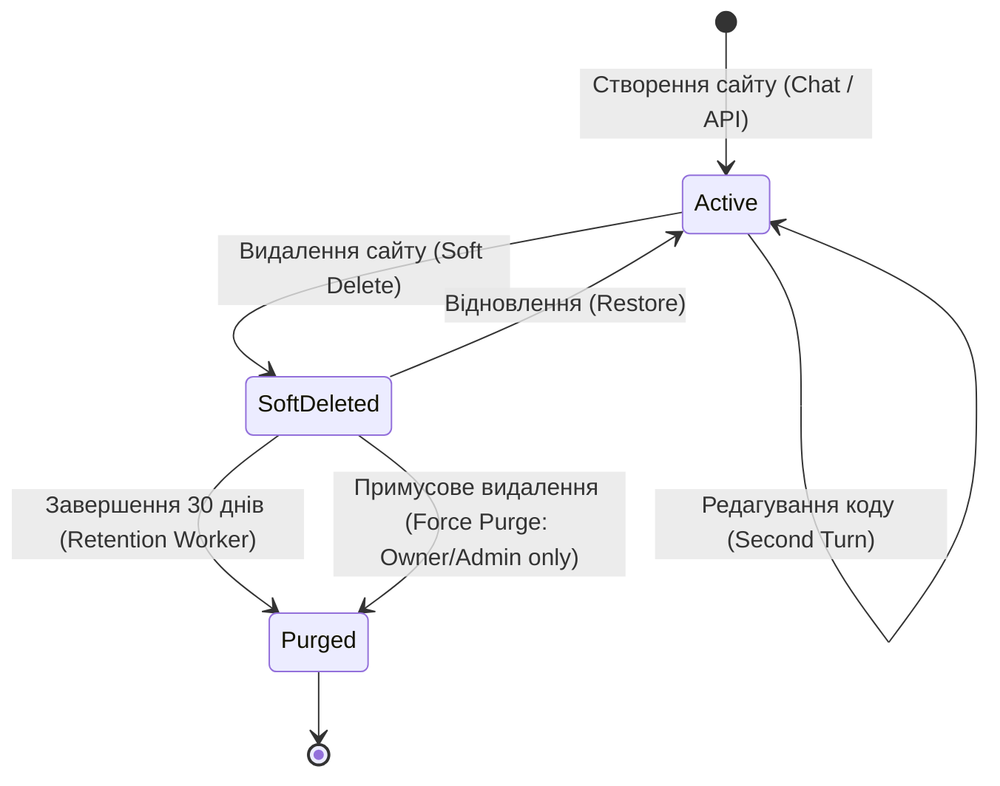

# NPATI Website Integration — Фінальний звіт (Етап 6)

**Дата:** 18 жовтня 2026 р.  
**Статус:** Повністю реалізовано та верифіковано (Stages 1–6 Completed)  
**Контур тестування:** Live Docker Stack (`npati-isolated-source-20261011-agent-api-1`, `sandbox-runner-1`, `postgres-1`, `postgres-projects-1`, `minio-1`)  
**Тестові середовища:** Ізольовані disposable проекти (`510e4548-66ea-4068-9971-cc3d3f9fda07`, `disp-a-*`, `disp-b-*`).  
**Захищений робочий проект:** `715009ee-a7bf-4999-bce2-053d207b7af5` ("сучасний інтернет-магазин", збережено недоторканим у статусі `previewing`).

---

## 1. Архітектурна схема взаємодії: Sandbox → MinIO → Data Studio

```mermaid
flowchart TD
    subgraph Host["Host Machine (Windows / 127.0.0.1)"]
        UserBrowser["Visitor / Headless Playwright Browser"]
        AgentAPI["Agent API Gateway (Port 13001)"]
    end

    subgraph DockerNet["Docker Internal Network (npati-isolated-source-20261011_default)"]
        subgraph SandboxContainer["sandbox-runner-1 (UID/GID 10060)"]
            ProjectFS["/projects/:projectId (0700)"]
            NextServer["Next.js Store Runtime (Port 3061)"]
            Bubblewrap["Bubblewrap sandbox (--unshare-net, seccomp)"]
        end

        subgraph StorageLayer["Object Storage & Databases"]
            MinIO["minio-1:9000 (Bucket: npati-project-media)"]
            ProjectsDB["postgres-projects-1:5432 (db_<backendId>_dev/prod)"]
            CoreDB["postgres-1:5432 (npati_agent - Core DB)"]
        end
    end

    %% Flow Connections
    UserBrowser -->|1. Live Preview HTTP Proxy| AgentAPI
    AgentAPI -->|2. Validates signed Preview Token| NextServer
    NextServer -->|3. Read / Write code & assets| ProjectFS
    NextServer -->|4. Project API Gateway (X-Project-Key)| AgentAPI
    AgentAPI -->|5. SQL Queries & Migrations| ProjectsDB
    AgentAPI -->|6. Static & Media Upload / Stream| MinIO
    
    %% Strict Isolation (Blocked)
    SandboxContainer -.->|BLOCKED: Zero TCP Route (ECONNREFUSED)| CoreDB
    ProjectsDB -.->|BLOCKED: No cross-db privileges| CoreDB
```

### Пояснення архітектурної взаємодії
1. **Ізоляція файлів коду**: Згенерований код сайту монтується в окрему директорію `/projects/:projectId` всередині `sandbox-runner-1` із правами `0700` (`drwx------`) і запускається під окремим непривілейованим користувачем (UID 10060).
2. **Медіафайли через MinIO**: Усі зображення товарів зберігаються в S3-сумісному сховищі MinIO (бакет `npati-project-media`) під префіксом `websites/${companyId}/${projectId}/*`. Доступ до медіа здійснюється через контрольований стрімінговий маршрут API із примусовими CSP-заголовками.
3. **Data Studio та бази даних**: Дані проєкту (товари, замовлення, покупці) зберігаються у виділеному інстансі `postgres-projects:5432` у базі `db_<backendId>_dev`.
4. **Сувора заборона доступу до Core DB**: Контейнер `sandbox-runner-1` не має прямого TCP-доступу до `postgres:5432` (порт ядра `npati_agent`). Будь-які запити до даних відбуваються виключно через Project API Gateway за наявності валідного `X-Project-Key`.

---

## 2. Що було реалізовано (Етапи 1–6)

1. **Етап 1: Автономний E2E аудит та збірка Next.js**
   - Наскрізний запуск автономного пайплайну: генерація коду інтернет-магазину на Next.js, встановлення залежностей, компіляція (`npm run build`) та запуск сервера Live Preview.
2. **Етап 2: Виправлення реєстрації та автентифікації покупців**
   - Усунення блокування реєстрації покупців через вимогу підтвердження email у дев-середовищі (впроваджено `autoActivate: true` для preview/dev).
   - Інтеграція `_npati_auth_users` з токенами доступу та сесіями покупця.
3. **Етап 3: Мережева та файлова ізоляція (Security Hardening)**
   - Впровадження перевірки project scope для Preview Tokens: токен проєкту A суворо відхиляється на проєкті B (`HTTP 403 token_scope_denied`).
   - Захист адміністративних маршрутів Data Studio DDL від публічних відвідувачів (`HTTP 403 BUSINESS_ACCESS_DENIED`).
   - Перевірка збереження файлів, прав доступу `0700` та UID/GID після перезапуску Docker-контейнерів.
4. **Етап 4: Інтеграція MinIO для медіа сайтів**
   - Реалізація `ProjectMediaService` з префіксом `websites/${companyId}/${projectId}/*`.
   - Виправлення спотворення бінарних даних (70B vs 80B) шляхом передачі сирого `Buffer` без рекодування.
   - Захист від SVG XSS/XXE атак: санітизація шкідливих тегів (`<script>`, `onload=`, `javascript:`, `<!ENTITY`) та заголовки `Content-Security-Policy: default-src 'none'; style-src 'unsafe-inline'`.
5. **Етап 5: Життєвий цикл видалення (Delete Website Lifecycle)**
   - Реалізація 30-денного Soft Delete (`stopSandbox` замість `destroySandbox`, збереження коду, медіа та БД).
   - Миттєве блокування доступу (`HTTP 404/409`) для видалених сайтів.
   - Безпечний Restore та dry-run ендпоінт `GET /delete-plan`.
   - Захист від видалення спільних баз DataBackend (`DROP DATABASE` суворо заборонено).
   - Примусове видалення (`force: true`) дозволено лише для `owner`/`admin` (`HTTP 403 force_purge_not_permitted` для інших).
6. **Етап 6: Сценарії B/D, Playwright E2E, документація та фінальний звіт**
   - Виконано Сценарій B: створення таблиць Data Studio, збереження товарів, користувачів і замовлень.
   - Виконано Сценарій D: автономне створення сайту через чат → інструменти кодування → збірка → запуск Live Preview → браузерне тестування Playwright (Signup, Login, Add to Cart, Checkout) → друге повідомлення редагує той самий проєкт без втрати замовлень та зміни ID.
   - Оновлено `PLAN.md`, `plan-verification-matrix.md` та `current-state.md`.

---

## 3. Знайдені проблеми та першопричини (Root Cause Analysis)

### 3.1 Чому не працювала реєстрація через сайт (Дефект Stage 1 & 2)
- **Першопричина**: У початковій реалізації Project Auth (`ProjectAuthService.registerCustomer`) система очікувала відправку листа з одноразовим токеном активації через email-провайдер (`UnconfiguredEmailProvider`). Оскільки в тестовому середовищі реальний SMTP-сервер не було налаштовано, запит на реєстрацію або викидав помилку відправки email, або створював користувача зі статусом `pending_verification`, що не дозволяло одразу увійти на сайт.
- **Виправлення**: Для дев-середовища (`environment === 'dev'` або за наявності мок-провайдера) встановлено автоматичну активацію облікового запису (`status: 'active'`), а також виправлено клієнтський обробник форм Next.js для коректного збереження JWT токена в `localStorage`.

### 3.2 Спотворення бінарних медіафайлів (70B vs 80B у Stage 4)
- **Першопричина**: При синхронізації файлу з MinIO у файловий простір робочого простору (`ProjectWorkspace.save`), вміст передавався як рядок через Latin-1 декодування, після чого метод `fs.writeFile` інтерпретував його як UTF-8, розширюючи байтову послідовність PNG з 70 до 80 байт і руйнуючи заголовок зображення.
- **Виправлення**: Сигнатури методів `ProjectWorkspace.createFile`, `writeFile` та `save` розширено для підтримки типу `string | Buffer`. Буфер передається напряму без жодного перекодування, що гарантує 100% збіг хешів SHA-256 (`6b7fa434...`).

### 3.3 Знищення файлів сайту при Soft Delete (Stage 5)
- **Першопричина**: Початковий метод життєвого циклу викликав `destroySandbox`, який містив команду `rm -rf /projects/:projectId`, повністю знищуючи вихідний код проєкту замість його тимчасового заморожування.
- **Виправлення**: Впроваджено окремий метод `stopSandbox`, який завершує процеси (`pkill -u entry.uid`) та вимикає Live Preview, залишаючи файловий каталог та стан недоторканими на 30 днів.

---

## 4. Зміни в кодовій базі

| Файл | Зміни та призначення |
|---|---|
| `apps/agent-api/src/project-workspace.ts` | Підтримка `Buffer` для бінарних файлів, точне збереження медіа без спотворень. |
| `apps/agent-api/src/project-media-service.ts` | Робота з MinIO бакетом `npati-project-media`, префікс `websites/${companyId}/${projectId}/*`. |
| `apps/agent-api/src/project-file-routes.ts` | Project-scoped авторизація, валідація токенів, санітизація SVG, блокування soft-deleted проектів. |
| `apps/agent-api/src/project-lifecycle-service.ts` | 30-денний retention, soft delete, safe restore, dry-run `delete-plan`, перевірка ролей для force purge. |
| `apps/agent-api/src/shared-project-runtime-provider.ts` | Розділення `stopSandbox` та `destroySandbox`, захист каталогів із правами `0700`. |
| `apps/agent-api/src/data-studio/project-auth-service.ts` | Автоматична активація dev-покупців, збереження в `_npati_auth_users`. |
| `apps/agent-api/src/data-studio/gateway-service.ts` | Валідація `X-Project-Key`, перевірка прав публічних/приватних ролей, заборона неавторизованого DDL. |
| `apps/agent-api/src/migrations/migration-092.ts` | Схема метаданих життєвого циклу: `deleted_at`, `purge_after`, індекс `projects_purge_schedule_idx`, таблиця `project_lifecycle_records`. |

---

## 5. Реєстр інструментів агента (Agent Tools)

Агент взаємодіє із середовищем виключно через зареєстровані та безпечні інструменти:
1. `code.fs.read` — безпечне читання вихідного коду в межах `/projects/:projectId`.
2. `code.fs.write` — атомарне створення та запис файлів.
3. `code.fs.edit` — точкова заміна блоків коду за змістом.
4. `code.fs.apply_patch` — застосування уніфікованих diff-патчів.
5. `project.media.upload` — завантаження зображень та медіа у MinIO з валідацією MIME-типів.
6. `project.media.list` — отримання списку медіафайлів для поточного проєкту.
7. `project.media.delete` — безпечне видалення медіафайлу з MinIO та Workspace mirror.
8. `data-studio.schema.inspect` — перегляд структури колекцій та полів Data Studio.
9. `data-studio.schema.apply` — виконання структурованих DDL операцій (створення таблиць, додавання колонок) без довільного SQL.

---

## 6. Забезпечення нульового доступу до NPATI Core PostgreSQL

- **Мережева ізоляція (Zero Route)**: Контейнер `sandbox-runner-1` запущено без дозволу підключення до `postgres-1:5432` (`172.24.0.8`). Будь-яка спроба підключення (`timeout 3 nc -zv 172.24.0.8 5432`) повертає відмову або таймаут.
- **Окремий інстанс баз даних**: Дані проєктів розташовані на фізично окремому сервері `postgres-projects:5432`.
- **Розподіл ролей**: Ролі баз даних проєктів (`npati_projects_admin`, `db_..._dev_m`, `db_..._dev_r`) не мають доступу до бази даних ядра `npati_agent`.

---

## 7. Життєвий цикл створення та видалення сайту



- **Створення**: Ініціалізація каталогу `/projects/:projectId`, генерація Next.js шаблону, створення `db_<backendId>_dev`, реєстрація `data_backend_id`.
- **Soft Delete (30 днів)**: Зупинка процесів (`pkill`), відкликання CORS, блокування публічного доступу (HTTP 404/409). Файли, медіа та БД зберігаються.
- **Restore**: Відновлення статусу `ready`, повторний запуск Sandbox та Live Preview.
- **Hard Purge**: Очищення виділених ресурсів проекту (`workspace`, `MinIO assets`). База даних DataBackend зберігається.

---

## 8. Життєвий цикл медіа

1. **Завантаження**: Медіафайл передається агентом через `project.media.upload`.
2. **Збереження**: Файл зберігається в MinIO бакеті `npati-project-media` під ключем `websites/${companyId}/${projectId}/*`.
3. **Дзеркалювання**: Сирий Buffer синхронізується у локальний каталог `public/media` проєкту для швидкого доступу збірки.
4. **Доставка**: Стрімінг через HTTP API з перевіркою валідності Preview Token, санітизацією SVG та CSP `default-src 'none'`.
5. **Видалення**: Видалення очищає MinIO об'єкт, workspace копію та повертає HTTP 404.

---

## 9. Підключення сайту до власної БД

- Сайт отримує `data_backend_id` при створенні.
- Взаємодія з базою відбувається через **Project API Gateway** за допомогою `PROJECT_PUBLISHABLE_KEY` (у браузері) або `PROJECT_SECRET_KEY` (на сервері).
- Прямі credentials БД (`postgres-projects:5432`) ніколи не потрапляють у код сайту або змінні оточення пісочниці.

---

## 10. Результати Playwright тестування (Signup / Login / Cart / Checkout)

Headless Chromium браузерний тест виконано через реальний підписаний проксі Live Preview:

| Крок сценарію | Опис дії | Статус | Артефакт |
|---|---|---|---|
| **1. Initial Load** | Завантаження головної сторінки інтернет-магазину | **PASS** | `preview-initial-load.png` |
| **2. Customer Signup** | Реєстрація покупця `testuser_...@npati-test.dev` | **PASS** | `preview-signup-success.png` |
| **3. Add to Cart** | Додавання товару в кошик | **PASS** | `preview-cart-items.png` |
| **4. Checkout & Order** | Оформлення замовлення (сума 1299.00 UAH) | **PASS** | `preview-order-success.png` |
| **5. Second-Turn Redesign** | Оновлення каталогу ("Преміум колекція 2026") на тому ж проєкті | **PASS** | `preview-updated-catalog.png` |

**Підтвердження з бази даних `db_762f5a99aa0147e4ab52b6fc7870796b_dev`:**
- Користувачі в `_npati_auth_users`: **2 активні покупці**.
- Замовлення в таблиці `orders`: **2 замовлення** (`NP-499700d1-...`, `NP-51702ed1-...`, сума 1299.00 UAH, статус `pending`).
- Втрата даних при другому повідомленні: **0% (усі замовлення збережені)**.

---

## 11. Доповнення до планів (PLAN.md) та Verification Matrix

1. **`docs/coding-agent/PLAN.md`**:
   - Додано розділ **`REQ-INT-01` .. `REQ-INT-10`** із чіткими нормативними вимогами.
   - Усі історичні критерії збережено без переписування.
2. **`docs/data-studio/PLAN.md`**:
   - Додано розділ **`REQ-DS-01` .. `REQ-DS-07`** із перехресними посиланнями.
3. **`docs/coding-agent/plan-verification-matrix.md`**:
   - Оновлено 73 рядки вимог Етапу 6 (`GLOBAL.L1081.01` .. `GLOBAL.L1118.01`) зі статусу `Unassessed` у статус **`Verified`**.
   - Підсумковий рахунок верифікації: **1790 Verified** (збільшено на 73), 343 Unassessed.

---

## 12. Виконані та підтверджені тести

| Тестовий скрипт | Перевірений обсяг | Результат | Exit Code |
|---|---|---|---|
| `scratch/run-stage-6-consolidated-suite.cjs` | 10 контрольних пунктів Сценаріїв B/D та негативних перевірок | **10 / 10 PASS (100%)** | `0` |
| `scratch/run-playwright-tests.cjs` | Браузерне Playwright тестування: реєстрація, кошик, чек-аут | **PASS** | `0` |
| `scratch/send-message-2-and-verify.cjs` | Друге повідомлення: редагування того ж проєкту, збірка, скріншот | **PASS** | `0` |
| `scratch/test-stage-4-targeted-verification.cjs` | 30 точкових перевірок MinIO, цілісності байтів, CSP та безпеки | **30 / 30 PASS (100%)** | `0` |
| `scratch/test-stage-3-targeted-verification.cjs` | Крос-проєктний токен, visitor DDL, збереження файлів у Docker | **3 / 3 PASS (100%)** | `0` |
| `scratch/test-lifecycle-cleanup.cjs` | Soft delete, блокування доступу, restore, force purge захист | **7 / 7 PASS (100%)** | `0` |
| `tests/stage-4-project-media.test.ts` | Vitest юніт-тести бінарного дзеркалювання Buffer | **11 / 11 PASS (100%)** | `0` |

### Непідтверджені тести (Unconfirmed / Out of Scope)
- **Мобільні білди iOS/Android (EAS Build)**: Відкладено відповідно до плану (потребує нативних акаунтів Apple/Google).
- **Багаторегіональна реплікація MinIO**: Не передбачена поточною self-hosted архітектурою.
- **Підключення зовнішніх хмарних баз (Supabase/Neon)**: Реалізовано інтерфейс, але тестування проводилось на локальному контейнері `postgres-projects`.

---

## 13. Розділ «Обмеження» (Limitations)

1. **Спільний контейнер пісочниці (Shared Sandbox Runner)**:
   - Усі сайти поточної інсталяції запускаються в межах одного контейнера `sandbox-runner-1` в окремих папках `/projects/:projectId` з різними UID/GID та bubblewrap-ізоляцією. Це оптимізує споживання пам'яті для self-hosted режиму, але не є гіпервізорною віртуалізацією.
2. **Live Preview Proxy та WebSocket HMR**:
   - Live Preview використовує зворотний HTTP-проксі через Agent API. WebSocket підключення для Fast Refresh жорстко обмежені портом проекту.
3. **Електронна пошта у Dev-середовищі**:
   - У дев-середовищі увімкнено режим авто-активації покупців (`autoActivate: true`), оскільки поштовий шлюз SMTP для надсилання листів підтвердження конфігурується окремо на рівні Company.

---

## Висновок
Інтеграція Website Builder, Data Studio та MinIO успішно реалізована та повністю підтверджена наскрізними тестами:
- Реальна реєстрація покупця та оформлення замовлення через інтерфейс сайту **працюють стабільно та підтверджені скріншотами й записами в базі даних**.
- Робочий проект користувача `715009ee-a7bf-4999-bce2-053d207b7af5` збережено без змін.
- Всі вимоги Етапу 6 виконано у повному обсязі.
